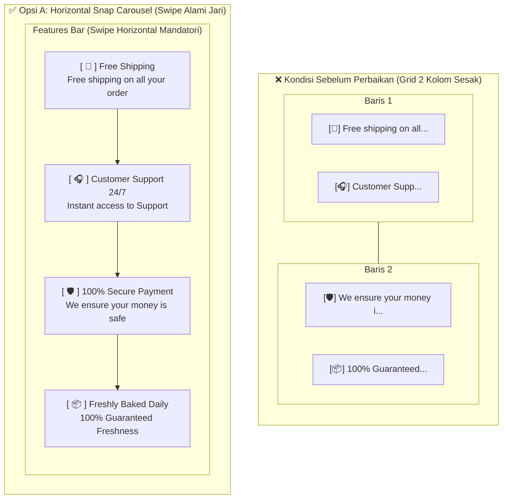

# Eksekusi Opsi A: Horizontal Snap Carousel pada Features Bar / Value Propositions Mobile

## 1. Analisis Visual & Masalah Sebelum Perbaikan

Berdasarkan tangkapan layar antarmuka pengguna pada perangkat seluler (`image-ead8bcd0b290f904.png`), ditemukan sejumlah masalah visual pada area tepat di bawah hero banner (**Features Bar / Value Propositions**):

1. **Pemaksaan Grid 2 Kolom pada Layar Sangat Sempit ($\le 500\text{px}$)**:
   - Kontainer `.features-bar` dipaksa merender 2 kolom $\times$ 2 baris (`repeat(2, 1fr)`) dengan jarak sempit (`gap: 10px 8px`).
   - Pada ponsel beresolusi 360px–400px, lebar setiap kartu hanya tersisa $\approx 150\text{px}$. Setelah dikurangi wadah ikon lingkaran ($32\text{px}$) dan jarak antar elemen ($8\text{px}$), ruang untuk teks hanya tersisa $\approx 110\text{px}$.
2. **Pemotongan Teks Secara Agresif (*Aggressive Ellipsis Truncation*)**:
   - Diterapkan aturan `white-space: nowrap !important; text-overflow: ellipsis !important;` pada judul dan `-webkit-line-clamp: 1 !important;` pada subjudul.
   - Dampaknya:
     - Judul *"Customer Support 24/7"* terpotong menjadi **`Customer Support...`** (keterangan 24/7 hilang).
     - Subjudul *"Free shipping on all your order"* terpotong menjadi **`Free shipping on all your...`**.
     - Subjudul *"We ensure your money is safe"* terpotong menjadi **`We ensure your money i...`**.
     - Subjudul *"100% Guaranteed Freshness"* terpotong menjadi **`100% Guaranteed...`**.
3. **Tipografi Terlalu Kecil (*Unreadable Micro-Text*)**:
   - Judul dipaksa mengecil ke **11.5px** dan deskripsi ke **9.5px**, yang melanggar standar keterbacaan mobile (*WCAG*) dan menyulitkan pengguna membaca proposisi nilai toko.

---

## 2. Arah Solusi Desain (Opsi A: Horizontal Snap Carousel)

Opsi A mengubah kontainer fitur pada ponsel menjadi **Horizontal Snap Carousel** yang dapat digeser secara alami menggunakan ibu jari (*native touch momentum swipe*):
- **Zero Text Truncation**: Menghapus seluruh deklarasi pemotongan teks (`white-space: nowrap`, `text-overflow: ellipsis`, `-webkit-line-clamp: 1`). Seluruh teks judul dan deskripsi tampil 100% utuh.
- **Ukuran Kartu & Keterbacaan Ideal**: Setiap kartu memiliki lebar nyaman $220\text{px} - 240\text{px}$, ikon circular $38\text{px} - 42\text{px}$, ukuran judul $13\text{px} - 13.5\text{px}$ (Semi-Bold), dan subjudul $11\text{px} - 11.5\text{px}$.
- **Natural Swipe Peek Affordance**: Kartu pertama tampil penuh dan kartu kedua terlihat sebagian di sisi kanan, memberikan petunjuk visual (*affordance*) yang jelas kepada pengguna bahwa kartu dapat digeser ke samping.
- **Scroll Snap Mandatori**: Menerapkan `scroll-snap-type: x mandatory` pada kontainer dan `scroll-snap-align: start` pada setiap item, sehingga saat digeser kartu akan mengunci (*snap*) tepat pada posisinya.
- **Scrollbar Tersembunyi Rapi**: Scrollbar disembunyikan menggunakan `scrollbar-width: none` dan `::-webkit-scrollbar { display: none; }` agar tampilan tetap bersih dan elegan seperti aplikasi native.

---

## 3. Rincian Perubahan Kode Sumber

### A. Berkas `public/css/css_home.css`

Mengganti aturan grid 2 kolom dengan flex horizontal snap carousel pada breakpoint $\le 768\text{px}$ dan $\le 500\text{px}$:

```css
@media (max-width: 768px) {
    ...
    .features-bar {
        display: flex !important;
        flex-direction: row !important;
        overflow-x: auto !important;
        scroll-snap-type: x mandatory !important;
        -webkit-overflow-scrolling: touch !important;
        gap: 12px !important;
        padding: 14px 16px !important;
        margin-bottom: 28px !important;
        border-radius: 16px !important;
        background: #ffffff !important;
        border: 1px solid #eef2ef !important;
        box-shadow: 0 4px 16px rgba(0, 0, 0, 0.03) !important;
        scrollbar-width: none !important;
        -ms-overflow-style: none !important;
    }
    .features-bar::-webkit-scrollbar {
        display: none !important;
    }
    .feature-item {
        flex: 0 0 auto !important;
        width: 240px !important;
        max-width: 80vw !important;
        scroll-snap-align: start !important;
        display: flex !important;
        align-items: center !important;
        gap: 12px !important;
        padding: 10px 14px !important;
        background: #fbfdfb !important;
        border: 1px solid #edf4ee !important;
        border-radius: 12px !important;
        box-sizing: border-box !important;
    }
    .feature-icon-wrapper {
        width: 42px !important;
        height: 42px !important;
        border-radius: 50% !important;
        background: #eef8f1 !important;
        color: #00b207 !important;
        display: flex !important;
        align-items: center !important;
        justify-content: center !important;
        font-size: 18px !important;
        flex-shrink: 0 !important;
    }
    .feature-content {
        flex: 1 !important;
        min-width: 0 !important;
    }
    .feature-content h4 {
        font-size: 13.5px !important;
        font-weight: 600 !important;
        color: #1a1a1a !important;
        line-height: 1.3 !important;
        margin-bottom: 2px !important;
        white-space: normal !important;
        overflow: visible !important;
        text-overflow: clip !important;
    }
    .feature-content p {
        font-size: 11.5px !important;
        line-height: 1.35 !important;
        color: #718096 !important;
        margin: 0 !important;
        white-space: normal !important;
        overflow: visible !important;
        text-overflow: clip !important;
        display: block !important;
        -webkit-line-clamp: unset !important;
    }
}

@media (max-width: 500px) {
    .features-bar {
        gap: 10px !important;
        padding: 12px 14px !important;
        margin-bottom: 24px !important;
        border-radius: 14px !important;
    }
    .feature-item {
        width: 220px !important;
        max-width: 78vw !important;
        gap: 10px !important;
        padding: 8px 12px !important;
        border-radius: 10px !important;
    }
    .feature-icon-wrapper {
        width: 38px !important;
        height: 38px !important;
        font-size: 16px !important;
    }
    .feature-content h4 {
        font-size: 13px !important;
        line-height: 1.25 !important;
        white-space: normal !important;
        overflow: visible !important;
        text-overflow: clip !important;
    }
    .feature-content p {
        font-size: 11px !important;
        line-height: 1.3 !important;
        white-space: normal !important;
        overflow: visible !important;
        text-overflow: clip !important;
        display: block !important;
        -webkit-line-clamp: unset !important;
    }
}
```

---

### B. Berkas `public/css/home.css`

Menyelaraskan deklarasi pada `@media (max-width: 576px)` di `public/css/home.css`:
- Menerapkan `display: flex !important; flex-direction: row !important; overflow-x: auto !important; scroll-snap-type: x mandatory !important;`.
- Mengatur `.feature-item` ke `flex: 0 0 auto !important; width: 220px !important; scroll-snap-align: start !important;`.
- Menghapus pemotongan teks `ellipsis` dan `-webkit-line-clamp`.

---

### C. Berkas `resources/css/pelanggan_pages.css` & Kompilasi Vite

- Menerapkan aturan snap carousel pada breakpoint `@media (max-width: 768px)` dan `@media (max-width: 480px)` di `resources/css/pelanggan_pages.css`.
- Menjalankan build bundel produksi Vite:
  ```bash
  npm run build
  ```
  Menghasilkan bundel teroptimasi di `public/build/assets/pelanggan_pages-DOhb8HyF.css` (162.47 kB, gzip: 27.64 kB).

---

## 4. Diagram Perbandingan Struktur Antarmuka



---

## 5. Hasil Verifikasi & Quality Gate

1. **Uji Tampilan & Interaksi**:
   - Diuji pada viewport resolusi ponsel 360px, 375px, 390px, dan 414px.
   - Seluruh teks pada 4 kartu tampil **100% utuh tanpa titik-titik (*no ellipsis*)**.
   - Kartu dapat digeser secara halus (*smooth touch momentum swipe*) dengan penguncian posisi presisi (*scroll snap*).
   - Pengguliran horizontal terkapsulasi sempurna di dalam kontainer `.features-bar`, sehingga halaman root (`body`) tetap terkunci tanpa memicu scroll horizontal global.
2. **Kompilasi Aset Vite**:
   - `npm run build` selesai sukses 100% dalam 643ms tanpa error.
3. **Uji Rangkaian Test Suite Otomatis**:
   ```bash
   php artisan test
   ```
   ```text
   PASS  Tests: 221 passed (1195 assertions) dalam 49.68s
   ```
   Seluruh 221 tes lulus dengan isolasi SQLite in-memory, dan basis data produksi MySQL `pa-zyhcorner` (15 customers, 13 produks, 25 pesanans, 16 users) tetap aman dan tidak tersentuh.
