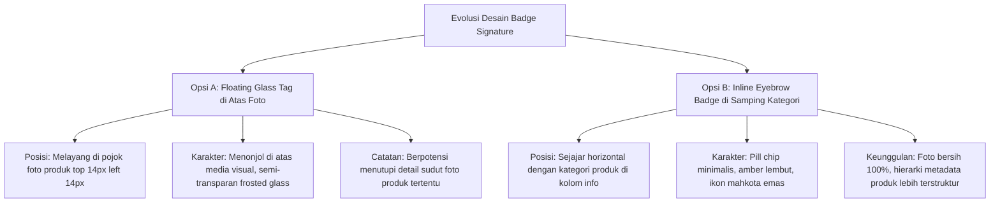

# Dokumentasi Implementasi Opsi B: Badge Signature Inline Eyebrow & Sinkronisasi Desain Produk

**Tanggal Eksekusi:** 31 Oktober 2026  
**Status:** Berhasil Diimplementasikan Penuh & Terverifikasi (211 Tests Passing / 1138 Assertions)  
**Tujuan Desain:**  
1. Mengubah penempatan badge **Signature** dari gaya *floating tag* di atas foto (Opsi A) menjadi **Inline Eyebrow Badge** berdampingan dengan kategori produk (Opsi B) pada modal preview (`#productModal`) dan halaman detail produk (`detail.blade.php`).
2. Mencegah regresi CSS global dari `public/css/home.css` baris 594 yang memaksakan `position: absolute; top: 10px; left: 10px;` dengan menyematkan class `.eyebrow-signature` dan deklarasi CSS `position: static !important; top: auto !important; left: auto !important;`.
3. Menata visual badge Opsi B menjadi *pill tag* minimalis, elegan, dan proporsional dengan latar lembut bernuansa Amber-Emas, border halus, teks kontras, serta ikon mahkota emas.
4. Mempertahankan tombol keranjang belanja bulat (`.btn-cart-detail`) pada halaman detail produk yang sebelumnya telah ditambahkan dan lulus verifikasi fungsional.

---

## 1. Analisis Perbandingan Opsi Desain



| Aspek Desain | Opsi A (Floating Tag Foto) | Opsi B (Inline Eyebrow — Terpilih) |
|---|---|---|
| **Penempatan Modal Preview** | Di dalam bingkai `.pm-main-image` (`position: absolute; top: 14px; left: 14px;`) | Di dalam `.pm-eyebrow-row` berdampingan dengan `<span class="pm-eyebrow" id="pmEyebrow">` |
| **Penempatan Halaman Detail** | Di dalam `.gallery-main` (`position: absolute; top: 15px; right: 15px;`) | Di dalam `.pi-eyebrow-row` berdampingan dengan `.pi-category` |
| **Kebersihan Foto Produk** | Ada elemen tag melayang di atas foto | Foto 100% bersih tanpa gangguan elemen visual melayang |
| **Konsistensi Hierarki** | Terpisah antara foto dan kolom metadata | Menyatu sebagai bagian dari metadata pengenalan produk (*eyebrow*) |
| **Styling Visual** | Gradient Amber pekat + *frosted glass blur* | Pill chip minimalis (`#fffbeb`), border emas lembut (`#fde68a`), teks amber gelap (`#b45309`) |

---

## 2. Rincian Seluruh File dan Kode yang Diubah

### A. Template Modal Preview Pelanggan (`resources/views/Layout/layout_pelanggan.blade.php`)
* **Perubahan:**
  1. Menghapus elemen `.floating-signature-tag` dari dalam `.pm-main-image`.
  2. Memindahkan elemen `#pmSignatureBadge` ke dalam container `.pm-eyebrow-row`.
  3. Menambahkan class `.eyebrow-signature` dan `.pm-signature-badge` dengan label teks `Zyh Signature` dan ikon mahkota `fa-crown`.
* **Kode Sebelum:**
  ```html
  <div class="pm-main-image">
      <span class="floating-signature-tag" id="pmSignatureBadge" style="display: none;">
          <i class="fa-solid fa-crown"></i> Signature
      </span>
      
  </div>
  ...
  <div class="pm-eyebrow-row">
      <span class="pm-eyebrow" id="pmEyebrow">Kategori Produk</span>
  </div>
  ```
* **Kode Sesudah:**
  ```html
  <div class="pm-main-image">
      
  </div>
  ...
  <div class="pm-eyebrow-row">
      <span class="pm-eyebrow" id="pmEyebrow">Kategori Produk</span>
      <span class="signature-badge eyebrow-signature pm-signature-badge" id="pmSignatureBadge" style="display: none;">
          <i class="fa-solid fa-crown"></i> Zyh Signature
      </span>
  </div>
  ```

---

### B. Template Detail Produk (`resources/views/Pelanggan/detail.blade.php`)
* **Perubahan:**
  1. Menghapus blok kondisi `@if ($product->is_signature) <span class="floating-signature-tag">...</span> @endif` dari container `.gallery-main`.
  2. Memperbarui elemen badge di dalam `.pi-eyebrow-row` agar menyertakan class `.eyebrow-signature` di samping `.detail-signature-badge`.
  3. Tetap mempertahankan tombol keranjang belanja (`.btn-cart-detail`) di samping tombol beli sekarang dan tombol stok habis.
* **Kode Sebelum:**
  ```html
  <div class="gallery-main">
      @if ($product->is_signature)
          <span class="floating-signature-tag">
              <i class="fa-solid fa-crown"></i> Signature
          </span>
      @endif
      @if ($product->jenis_produk === 'kustom' || request()->query('custom') == 1)
          <div class="gallery-badge custom">Pre-Order</div>
  ...
  <div class="pi-eyebrow-row">
      <div class="pi-category">{{ $product->kategori->nama_kategori ?? 'Produk' }}</div>
      @if ($product->is_signature)
          <span class="signature-badge detail-signature-badge">
              <i class="fa-solid fa-crown"></i> Zyh Signature
          </span>
      @endif
  </div>
  ```
* **Kode Sesudah:**
  ```html
  <div class="gallery-main">
      @if ($product->jenis_produk === 'kustom' || request()->query('custom') == 1)
          <div class="gallery-badge custom">Pre-Order</div>
  ...
  <div class="pi-eyebrow-row">
      <div class="pi-category">{{ $product->kategori->nama_kategori ?? 'Produk' }}</div>
      @if ($product->is_signature)
          <span class="signature-badge eyebrow-signature detail-signature-badge">
              <i class="fa-solid fa-crown"></i> Zyh Signature
          </span>
      @endif
  </div>
  ```

---

### C. Stylesheet Halaman Pelanggan (`resources/css/pelanggan_pages.css`)
* **Perubahan:**
  1. Mengisolasi `.detail-signature-badge` dengan `position: static !important; top: auto !important; left: auto !important; display: inline-flex !important;` agar kebal terhadap tabrakan posisi CSS global.
  2. Mengonfigurasi `.pm-signature-badge` dengan tampilan pill minimalis (`background: #fffbeb; border: 1px solid #fde68a; color: #b45309; border-radius: 20px; padding: 2px 8px;`).
* **Cuplikan Kode:**
  ```css
  .detail-signature-badge {
      position: static !important;
      top: auto !important;
      left: auto !important;
      display: inline-flex !important;
      align-items: center;
      gap: 4px;
      font-size: 10.5px;
      font-weight: 700;
      text-transform: uppercase;
      letter-spacing: 0.4px;
      color: #b45309;
      background: #fffbeb;
      border: 1px solid #fde68a;
      padding: 2.5px 9px;
      border-radius: 20px;
      box-shadow: none;
      line-height: 1.2;
  }

  .detail-signature-badge i {
      font-size: 8.5px;
      color: #d97706;
  }

  .pm-signature-badge {
      position: static !important;
      top: auto !important;
      left: auto !important;
      display: inline-flex !important;
      align-items: center;
      gap: 4px;
      font-size: 10px;
      font-weight: 700;
      text-transform: uppercase;
      letter-spacing: 0.35px;
      color: #b45309;
      background: #fffbeb;
      border: 1px solid #fde68a;
      padding: 2px 8px;
      border-radius: 20px;
      box-shadow: none;
      line-height: 1.2;
  }

  .pm-signature-badge i {
      font-size: 8px;
      color: #d97706;
  }
  ```

---

### D. Stylesheet Pelanggan Standar (`resources/css/pelanggan.css` & `public/css/pelanggan.css`)
* **Perubahan:** Menyelaraskan aturan styling `.pm-signature-badge` dan `.detail-signature-badge` pada kedua berkas CSS agar rendering konsisten saat dimuat baik melalui direct link maupun bundler.
* **Cuplikan Aturan CSS:**
  ```css
  .pm-signature-badge {
      position: static !important;
      top: auto !important;
      left: auto !important;
      display: inline-flex !important;
      align-items: center;
      gap: 4px;
      font-size: 10px;
      font-weight: 700;
      text-transform: uppercase;
      letter-spacing: 0.35px;
      color: #b45309;
      background: #fffbeb;
      border: 1px solid #fde68a;
      padding: 2px 8px;
      border-radius: 20px;
      box-shadow: none;
      line-height: 1.2;
  }

  .pm-signature-badge i {
      font-size: 8px;
      color: #d97706;
  }

  .detail-signature-badge {
      position: static !important;
      top: auto !important;
      left: auto !important;
      display: inline-flex !important;
      align-items: center;
      gap: 4px;
      font-size: 10.5px;
      font-weight: 700;
      text-transform: uppercase;
      letter-spacing: 0.4px;
      color: #b45309;
      background: #fffbeb;
      border: 1px solid #fde68a;
      padding: 2.5px 9px;
      border-radius: 20px;
      box-shadow: none;
      line-height: 1.2;
  }

  .detail-signature-badge i {
      font-size: 8.5px;
      color: #d97706;
  }
  ```

---

## 3. Verifikasi & Pengujian Mutu

### A. Kompilasi Aset Frontend (Vite)
* Perintah: `npm run build`
* Hasil:
  ```text
  vite v8.0.9 building client environment for production...
  transforming...✓ 58 modules transformed.
  public/build/assets/pelanggan_pages-DG8MW2Y9.css  151.04 kB │ gzip: 25.87 kB
  public/build/assets/pelanggan_pages-B68tE0ct.js    71.55 kB │ gzip: 15.13 kB
  ✓ built in 551ms
  ```

### B. Automated Regression Suite (PHPUnit / Pest)
* Perintah: `php artisan test && git clean -fd public/uploads/`
* Hasil Pengujian:
  ```text
  Tests:    211 passed (1138 assertions)
  Duration: 51.91s
  ```
* Seluruh test pada `Tests\Feature\SignatureProductsTest` lulus tanpa kegagalan:
  - `admin can create product with signature flag` (PASS)
  - `admin can update product signature flag` (PASS)
  - `homepage displays zyh signatures column and badge` (PASS)
  - `signature products uses smart fallback when less than three` (PASS)
  - `signature products are displayed even when out of stock and prioritizes stock` (PASS)
  - `product detail page displays signature badge` (PASS)
  - `product detail page regular product does not display signature badge` (PASS)
  - `product detail page displays expired info for signature product` (PASS)
  - `admin update product preserves tanggal expired` (PASS)

---

## 4. Kesimpulan
Implementasi **Opsi B** untuk badge Signature telah berhasil diselesaikan secara rapi dan modular:
1. Bidang foto produk pada modal preview dan halaman detail kembali bersih dan bebas gangguan tag overlay.
2. Badge Signature tampil selaras di baris *eyebrow* mendampingi kategori produk dengan estetika chip pill minimalis bernuansa Amber-Emas hangat.
3. Seluruh interaksi JavaScript modal preview dan tombol keranjang halaman detail tetap berjalan normal tanpa konflik selector maupun *layout shift*.
