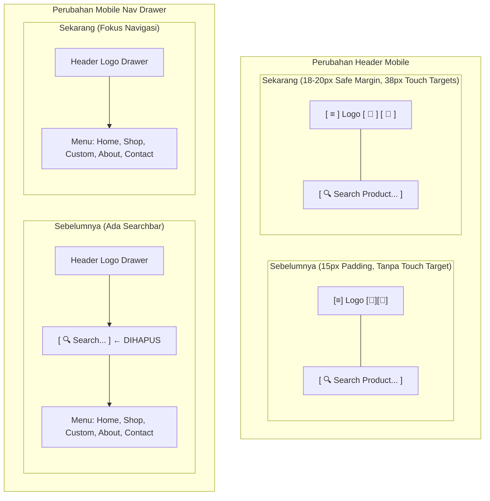

# Eksekusi Perbaikan Jarak Ikon Header dan Penghapusan Searchbar di Sidebar Mobile

## 1. Ringkasan & Latar Belakang

Perbaikan ini menindaklanjuti kebutuhan penyempurnaan antarmuka pengguna (*UI/UX*) pelanggan pada mode seluler (*mobile viewport*):
1. **Jarak Ikon Header/Navbar yang Terlalu Dempet ke Tepi Layar**:
   - Ikon menu hamburger di sisi kiri dan ikon aksi (keranjang belanja & profil/avatar) di sisi kanan sebelumnya terlalu mepet ke tepi kaca layar ponsel tanpa *safe margin* yang memadai.
   - Tombol hamburger sebelumnya memiliki inline style `padding: 5px 0` dengan lebar area sentuh minim, sehingga rentan memicu salah sentuh (*mis-click*) pada ponsel modern dengan bezel tipis atau layar melengkung.
2. **Searchbar Redundan di dalam Sidebar (Mobile Navigation Drawer)**:
   - Header mobile Zyh Corner sudah memiliki formulir pencarian produk langsung pada header (*dual-tier header*).
   - Keberadaan formulir pencarian kedua (`#mobileSearchForm`) di dalam drawer navigasi samping bersifat redundan dan memakan ruang vertikal drawer sebesar $\approx 60\text{px} - 70\text{px}$.

---

## 2. Rincian Perubahan Kode Sumber

### A. Berkas `resources/views/Layout/layout_pelanggan.blade.php`

1. **Pembersihan Inline Style pada Tombol Hamburger Menu**:
```diff
         <div class="logo">
-            <button class="mobile-menu-btn" onclick="toggleMobileMenu(true)"
-                style="background: none; border: none; font-size: 20px; color: #1a1a1a; cursor: pointer; display: none; margin-right: 5px; padding: 5px 0;">
-                <i class="fa-solid fa-bars"></i>
-            </button>
+            <button class="mobile-menu-btn" onclick="toggleMobileMenu(true)" aria-label="Buka Menu Navigasi">
+                <i class="fa-solid fa-bars"></i>
+            </button>
             
         <div class="mobile-nav-header">
             ...
         </div>
         <div class="mobile-nav-body">
-            <form id="mobileSearchForm" action="{{ request()->routeIs('custom-products') ? route('custom-products') : route('shop') }}" method="GET" style="margin-bottom: 20px; position: relative; overflow: visible !important;">
-                <div class="search-input-wrapper" style="border-radius: 6px;">
-                    <span style="padding-left: 12px; color: #999;"><i class="fa-solid fa-magnifying-glass"></i></span>
-                    <input type="text" name="search" id="mobileSearchInput" autocomplete="off" placeholder="Search Product. . ." value="{{ request('search') }}" style="flex: 1; padding: 10px 12px; border: none; outline: none; font-size: 14px;">
-                    <button type="submit" style="background: #00b207; color: white; border: none; padding: 10px 16px; font-weight: 500; font-size: 14px; cursor: pointer;">Search</button>
-                </div>
-                <div id="mobileSearchSuggestions" class="search-suggestions-dropdown" style="display: none;"></div>
-            </form>
             <div class="mobile-nav-links">
                 <a href="{{ route('home') }}" class="{{ request()->routeIs('home') ? 'active' : '' }}">Home</a>
```

3. **Pembersihan Listener Pencarian Mobile yang Tidak Lagi Digunakan**:
```diff
         initSearch('headerSearchInput', 'headerSearchSuggestions', 'headerSearchForm');
-        initSearch('mobileSearchInput', 'mobileSearchSuggestions', 'mobileSearchForm');
     });
```

---

### B. Berkas `resources/js/pelanggan_pages.js`

Menghapus inisialisasi live search untuk elemen `mobileSearchInput`:
```diff
     // Live search autocomplete initialization
     setupLiveSearch('headerSearchInput', 'headerSearchSuggestions', document.getElementById('headerSearchForm'));
-    setupLiveSearch('mobileSearchInput', 'mobileSearchSuggestions', document.getElementById('mobileSearchForm'));
 });
```

---

### C. Berkas `public/css/pelanggan.css` & `resources/css/pelanggan.css`

Menerapkan safe margin tepi layar dan micro-touch targets untuk tombol antarmuka mobile:
```css
@media (max-width: 991px) {
    .mobile-menu-btn {
        display: inline-flex !important;
        align-items: center;
        justify-content: center;
        width: 38px;
        height: 38px;
        background: #f8faf9;
        border: 1px solid #e2e8f0;
        border-radius: 8px;
        color: #1a1a1a;
        font-size: 18px;
        cursor: pointer;
        transition: all 0.2s ease;
        padding: 0 !important;
        margin-right: 6px !important;
    }
    .mobile-menu-btn:hover,
    .mobile-menu-btn:active {
        background: #edf5ee;
        border-color: #cbe3cf;
        color: #00b207;
    }
    .navigation {
        display: none !important;
    }
    .top-header,
    .container.top-header {
        display: flex !important;
        flex-wrap: wrap !important;
        justify-content: space-between !important;
        align-items: center !important;
        padding: 14px 20px 16px 20px !important;
        row-gap: 12px !important;
        box-sizing: border-box !important;
    }
    .top-header .logo {
        order: 1 !important;
        display: flex !important;
        align-items: center !important;
        gap: 8px !important;
    }
    .top-header .header-actions {
        order: 2 !important;
        display: flex !important;
        align-items: center !important;
        gap: 14px !important;
    }
    .top-header .cart-icon-wrapper {
        width: 38px;
        height: 38px;
        display: flex;
        align-items: center;
        justify-content: center;
        border-radius: 8px;
        background: #f8faf9;
        border: 1px solid #e2e8f0;
        transition: all 0.2s ease;
    }
    .top-header .cart-icon-wrapper:hover,
    .top-header .cart-icon-wrapper:active {
        background: #edf5ee;
        border-color: #cbe3cf;
    }
    .top-header .cart-icon-wrapper .action-icon {
        font-size: 18px;
        color: #1a1a1a;
    }
    .top-header #profileDropdownBtn {
        display: flex;
        align-items: center;
        justify-content: center;
        min-width: 38px;
        min-height: 38px;
    }
    .top-header #profileDropdownBtn .action-icon {
        width: 38px;
        height: 38px;
        display: flex;
        align-items: center;
        justify-content: center;
        border-radius: 8px;
        background: #f8faf9;
        border: 1px solid #e2e8f0;
        font-size: 18px;
        color: #1a1a1a;
        transition: all 0.2s ease;
    }
    .top-header #profileDropdownBtn:hover .action-icon,
    .top-header #profileDropdownBtn:active .action-icon {
        background: #edf5ee;
        border-color: #cbe3cf;
        color: #00b207;
    }
    ...
}

@media (max-width: 576px) {
    .top-header,
    .container.top-header {
        padding: 12px 18px 14px 18px !important;
        row-gap: 10px !important;
        box-sizing: border-box !important;
    }
    ...
}
```

---

### D. Berkas `resources/css/pelanggan_pages.css` & Kompilasi Vite

- Mengintegrasikan styling serupa pada `resources/css/pelanggan_pages.css` agar konsisten di seluruh halaman yang dimuat via bundel Vite.
- Mengompilasi ulang aset produksi menggunakan Vite:
  ```bash
  npm run build
  ```
  Menghasilkan build valid di `public/build/assets/pelanggan_pages-sMaPxfK6.css` dan `public/build/assets/pelanggan_pages-CzSEwIHz.js`.

---

## 3. Diagram Perubahan Antarmuka



---

## 4. Hasil Verifikasi & Quality Gate

1. **Uji Tampilan & Sentuhan Mobile**:
   - Ikon menu hamburger di sisi kiri berjarak nyaman $18\text{px} - 20\text{px}$ dari tepi kiri layar, dengan wadah tombol sentuh $38\text{px} \times 38\text{px}$ berlatar halus.
   - Ikon keranjang dan profil pengguna di sisi kanan berjarak $18\text{px} - 20\text{px}$ dari tepi kanan layar dengan wadah sentuh serupa dan jarak antar ikon $12\text{px} - 14\text{px}$.
   - Drawer navigasi samping kini langsung menampilkan menu tautan navigasi tanpa searchbar redundan.
2. **Kompilasi Aset Vite**:
   - `npm run build` sukses 100% tanpa galat syntax dalam 597ms.
3. **Uji Rangkaian Test Suite Otomatis**:
   ```bash
   php artisan test
   ```
   ```text
   PASS  Tests: 221 passed (1195 assertions) dalam 53.23s
   ```
   Semua pengujian lolos tanpa regresi, dengan isolasi SQLite in-memory yang melindungi database MySQL `pa-zyhcorner`.
