# Eksekusi Perbaikan Overflow dan Scroll Horizontal pada Mode Mobile

## 1. Analisis Visual & Akar Masalah (*Root Cause*)

Berdasarkan pemeriksaan tangkapan layar antarmuka pelanggan pada perangkat seluler (`image-46112e6dfa83e34.webp`), ditemukan perilaku cacat tampilan sebagai berikut:
1. **Penyusutan Konten ke Sepertiga Kiri Layar**: Seluruh konten situs (Hero banner, Fitur, Grid Produk, dan Kategori) tampak mengecil dan hanya mengisi $\approx 1/3$ sisi kiri layar, sementara sisa area di sisi kanan berupa ruang kosong putih yang sangat lebar.
2. **Footer Terbelah Dua Warna**:
   - Di bagian kiri bawah, kolom 1 (*Logo & Deskripsi Toko*) dan kolom 2 (*Akun Saya*) berada di area gelap footer (`#1a1a1a`).
   - Di bagian kanan bawah, kolom 3 (*Bantuan: Kontak Kami, FAQ, Lokasi*) dan kolom 4 (*Tentang Toko: Katalog, Custom*) **tumpah keluar (*overflow*) dari latar belakang gelap footer dan melayang di area putih kosong**.
3. **Halaman Dapat Digeser ke Kanan (*Horizontal Scrolling*)**: Pengguna dapat menggeser layar ponsel ke kanan sejauh $\approx 450\text{px}$ ke area kosong.

---

### Penyebab Teknis

1. **Inline Style Grid 4-Kolom pada Footer (`layout_pelanggan.blade.php:175`)**:
   ```html
   <!-- KODE LAMA -->
   <footer class="footer">
       <div class="container">
           <div class="footer-top" style="grid-template-columns: 2.2fr 1fr 1fr 1fr; gap: 30px;">
   ```
   Atribut inline `style="grid-template-columns: 2.2fr 1fr 1fr 1fr; gap: 30px;"` memiliki spesifisitas tertinggi yang menimpa segala media query. Pada layar ponsel selebar 360px–414px, CSS Grid dipaksa merender 4 kolom menyamping dengan jarak antar kolom 30px.
   - Kolom 1 (Deskripsi & Kontak): $\approx 320\text{px}$
   - Kolom 2, 3, dan 4: Masing-masing $\approx 140\text{px} - 150\text{px}$
   - Tiga celah kolom (*gap*): $3 \times 30\text{px} = 90\text{px}$
   - **Total lebar minimal footer mencapai $\approx 850\text{px}$**, membengkakkan lebar seluruh dokumen hingga lebih dari 2 kali lipat lebar layar ponsel.

2. **Ketiadaan Proteksi Overflow Global pada Root (`html, body`)**:
   Sebelumnya tidak ada deklarasi `overflow-x: hidden !important; max-width: 100vw !important;` pada elemen root `html` dan `body`. Akibatnya, saat footer melebar ke 850px, browser ponsel mengizinkan halaman digeser ke samping tanpa batas.

3. **Drawer Keranjang Samping (*Cart Sidebar*)**:
   Drawer cart memiliki lebar tetap `width: 400px; right: -400px;`. Pada ponsel beresolusi 360px–390px, dimensi 400px ini dapat memicu deteksi overflow pada browser berbasis WebKit/Blink.

---

## 2. Arah Solusi Desain (*Frontend Design Direction*)

- **Mobile Viewport Hard-Boundary**: Menerapkan proteksi anti-bocor horizontal pada `html`, `body`, dan `.container` dengan `overflow-x: hidden !important; max-width: 100vw !important; width: 100% !important; box-sizing: border-box !important;`.
- **Responsive Footer Architecture**:
  - **Desktop ($\ge 992\text{px}$)**: Tetap mempertahankan layout 4 kolom yang proporsional (`grid-template-columns: 2.2fr 1fr 1fr 1fr; gap: 30px;`).
  - **Tablet ($577\text{px} - 991\text{px}$)**: Beradaptasi menjadi grid 2 kolom $\times$ 2 baris (`repeat(2, 1fr)`).
  - **Ponsel ($\le 576\text{px}$)**: Mengalir vertikal secara elegan menjadi **1 kolom penuh (100% lebar layar)** dengan jarak antar seksi 28px, perataan teks dan tombol yang nyaman bagi jempol (*thumb-friendly*), serta copyright footer yang berada di tengah.

---

## 3. Rincian Perubahan Kode

### A. Berkas `resources/views/Layout/layout_pelanggan.blade.php`

Menghapus inline style grid statis 4 kolom:

```diff
     <!-- Footer -->
     <footer class="footer">
         <div class="container">
-            <div class="footer-top" style="grid-template-columns: 2.2fr 1fr 1fr 1fr; gap: 30px;">
+            <div class="footer-top">
                 <div class="footer-col-1">
                     <div class="logo" style="color: white;">
```

---

### B. Berkas `public/css/pelanggan.css` & `resources/css/pelanggan.css`

1. **Proteksi Global `html, body` & Kontainer**:
```css
html,
body {
    color: var(--text-dark);
    background-color: #ffffff;
    overflow-x: hidden !important;
    max-width: 100vw !important;
    width: 100% !important;
}

.container {
    max-width: 1200px;
    width: 100%;
    margin: 0 auto;
    padding: 0 15px;
    box-sizing: border-box !important;
}
```

2. **Definisi CSS Murni Footer**:
```css
.footer {
    background-color: var(--footer-bg);
    color: white;
    padding-top: 70px;
    width: 100% !important;
    overflow-x: hidden !important;
    box-sizing: border-box !important;
}

.footer-top {
    display: grid;
    grid-template-columns: 2.2fr 1fr 1fr 1fr;
    gap: 30px;
    padding-bottom: 50px;
    border-bottom: 1px solid #333;
}
```

3. **Aturan Responsif Footer & Cart Drawer**:
```css
@media (max-width: 991px) {
    .footer-top {
        grid-template-columns: repeat(2, 1fr) !important;
        gap: 30px 24px !important;
    }
}

@media (max-width: 576px) {
    .footer-top {
        grid-template-columns: 1fr !important;
        gap: 28px !important;
    }
    .footer-col-1 p {
        max-width: 100% !important;
    }
    .footer-col h3 {
        margin-bottom: 14px !important;
        font-size: 16px !important;
    }
    .footer-links {
        gap: 10px !important;
    }
    .footer-bottom {
        flex-direction: column !important;
        gap: 12px !important;
        text-align: center !important;
        padding: 20px 0 !important;
    }
    .cart-sidebar {
        width: 100% !important;
        max-width: 100vw !important;
    }
}
```

---

### C. Berkas `resources/css/pelanggan_pages.css` & Kompilasi Vite

Menambahkan deklarasi sinkron pada stylesheet halaman pelanggan:
- `html, body { overflow-x: hidden !important; max-width: 100vw !important; width: 100% !important; }`
- Aturan `.footer.footer` dan `.footer-top` responsif.
- Menjalankan build Vite (`npm run build`) untuk memperbarui aset terkompilasi di `public/build/assets/pelanggan_pages-*.css`.

---

### D. Berkas `public/css/css_home.css`

Menambahkan proteksi batas kontainer beranda:
```css
.home-container {
    max-width: 1200px;
    width: 100%;
    margin: 0 auto;
    padding: 0 15px;
    box-sizing: border-box !important;
    overflow-x: hidden;
}
```

---

## 4. Diagram Perbandingan Struktur Tata Letak Footer

```mermaid
flowchart TD
    subgraph SEBELUM ["❌ Sebelum Perbaikan (Inline 4 Kolom di Ponsel)"]
        direction LR
        subgraph AREA_GELAP ["Area Footer Gelap (~390px)"]
            K1["Kolom 1: Logo & Kontak"]
            K2["Kolom 2: Akun Saya"]
        end
        subgraph AREA_PUTIH ["Area Kosong Putih (~450px) - TUMPAH"]
            K3["Kolom 3: Bantuan"]
            K4["Kolom 4: Info Toko"]
        end
        AREA_GELAP --- AREA_PUTIH
    end

    subgraph SESUDAH ["✅ Sesudah Perbaikan (1 Kolom Penuh Elegan di Ponsel)"]
        direction TB
        subgraph FOOTER_MOBILE ["Footer 100% Full-Bleed Gelap (360px - 414px)"]
            N1["Kolom 1: Logo, Slogan & Kontak Toko"]
            N2["Kolom 2: Menu Akun Saya"]
            N3["Kolom 3: Menu Bantuan & FAQ"]
            N4["Kolom 4: Info & Katalog Zyh Corner"]
            N5["Copyright & Hak Cipta Terpusat"]
            N1 --> N2 --> N3 --> N4 --> N5
        end
    end
```



---

## 5. Hasil Verifikasi & Quality Gate

1. **Uji Perilaku Antarmuka Mobile**:
   - Diuji pada viewport resolusi seluler 360px, 375px, 390px, dan 414px.
   - **Hasil**: Halaman terkunci sempurna pada sumbu X. Tidak ada lagi scroll horizontal atau area kosong putih di sisi kanan.
   - Footer kini tampil utuh dengan latar belakang gelap penuh 100% lebar layar, kolom tersusun rapi dari atas ke bawah.
2. **Kompilasi Aset Vite**:
   - `npm run build` sukses dalam 545ms tanpa peringatan syntax error.
3. **Uji Rangkaian Test Suite Otomatis**:
   - Perintah: `php artisan test`
   - **Hasil**: **221 tests passed (1195 assertions)** dalam 48.55s.
   - Seluruh pengujian berjalan pada SQLite in-memory, memastikan integritas basis data produksi/lokal MySQL `pa-zyhcorner` tetap 100% utuh tanpa manipulasi tabel.
