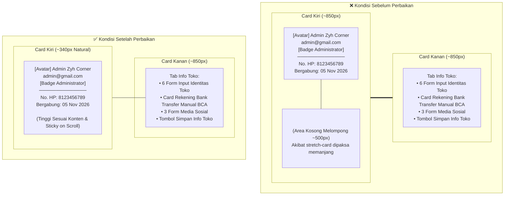

# Eksekusi Perbaikan Tampilan Card Pengaturan Admin & Toko

## 1. Latar Belakang & Masalah Tampilan

Pada halaman **Pengaturan Admin & Toko** (`/admin/settings`), antarmuka dibagi menjadi 2 kolom:
- **Kolom Kiri (Profil Admin)**: Menampilkan avatar foto profil, nama lengkap, email, badge status `Administrator`, serta ringkasan nomor HP dan tanggal bergabung. Tinggi konten alami hanya sekitar $\approx 340\text{px}$.
- **Kolom Kanan (Formulir Pengaturan)**: Terdiri dari 3 tab ("Profil Saya", "Keamanan & Password", dan "Info Toko").

### Masalah yang Terjadi
Pada tab **"Info Toko"**, formulir memiliki data yang sangat lengkap dan panjang:
1. Identitas Toko (Nama, Slogan, No. WhatsApp, Email, Jam Operasional, Alamat Lengkap).
2. Rekening Bank Transfer Manual (Nama Bank BCA, Nomor Rekening, Atas Nama).
3. Media Sosial Toko (Instagram, Facebook, TikTok).
4. Tombol Simpan Info Toko.

Tinggi formulir di kolom kanan mencapai $\approx 850\text{px} - 900\text{px}$. Karena kolom kiri sebelumnya dibungkus dengan kelas template Bootstrap/Purple `.stretch-card`:
```html
<!-- KODE LAMA -->
<div class="col-md-4 grid-margin stretch-card">
    <div class="card border-0 shadow-sm text-center p-4" style="border-radius: 8px; background: #ffffff;">
        <div class="card-body d-flex flex-column align-items-center justify-content-center">
```
Aturan `.stretch-card` memiliki properti `align-items: stretch` yang memaksa card kiri meregang ke bawah menyamai tinggi card kanan. Hal ini menyebabkan card profil admin di sebelah kiri **tertarik memanjang secara tidak wajar**, menyisakan area kosong putih (*empty white space*) yang sangat besar ($\approx 500\text{px}$) di bawah data tanggal bergabung.

---

## 2. Arah Solusi Desain (*Frontend Design Direction*)

1. **Eliminasi Peregangan Vertikal (*Stretch Removal*)**:
   Menghapus kelas `stretch-card` dari kolom kiri (`col-md-4`) dan menggantikannya dengan `align-self-start`. Card kiri dibiarkan memiliki tinggi alami (*fit-content*) sesuai isi kontennya.
2. **Sticky Anchoring**:
   Menambahkan `position: sticky; top: 90px; z-index: 10;` pada card profil admin. Ketika administrator menggulir layar (*scroll*) ke bawah untuk mengisi nomor rekening atau media sosial pada formulir yang panjang di kolom kanan, kartu profil admin tetap melayang (*sticky*) secara elegan dan selalu terlihat di layar monitor.
3. **Penyelarasan Desain (*Visual Polish*)**:
   - Menyelaraskan kelengkungan sudut (`border-radius: 12px`) agar seragam dengan card di sebelah kanan.
   - Menghapus double-padding (`p-4` di `.card` dipindahkan ke dalam `.card-body` standar).
   - Mengubah `justify-content-center` menjadi `justify-content-start` agar aliran konten rapi dari atas ke bawah.

---

## 3. Rincian Perubahan Kode

### Berkas: `resources/views/Admin/kelola_akun/settings.blade.php`

#### A. Perubahan Kolom Kiri (Profil Admin Card)

**Sebelum:**
```html
<!-- Left Column: Admin Profile Card Overview -->
<div class="col-md-4 grid-margin stretch-card">
    <div class="card border-0 shadow-sm text-center p-4" style="border-radius: 8px; background: #ffffff;">
        <div class="card-body d-flex flex-column align-items-center justify-content-center">
```

**Sesudah:**
```html
<!-- Left Column: Admin Profile Card Overview -->
<div class="col-md-4 grid-margin align-self-start">
    <div class="card border-0 shadow-sm text-center" style="border-radius: 12px; background: #ffffff; position: sticky; top: 90px; z-index: 10;">
        <div class="card-body p-4 d-flex flex-column align-items-center justify-content-start">
```

#### B. Perubahan Kolom Kanan (Formulir Pengaturan)

**Sebelum:**
```html
<!-- Right Column: Settings Tabs -->
<div class="col-md-8 grid-margin stretch-card">
    <div class="card border-0 shadow-sm" style="border-radius: 12px; background: #ffffff;">
```

**Sesudah:**
```html
<!-- Right Column: Settings Tabs -->
<div class="col-md-8 grid-margin">
    <div class="card border-0 shadow-sm" style="border-radius: 12px; background: #ffffff;">
```

---

## 4. Diagram Perbandingan Struktur Tata Letak



---

## 5. Hasil Verifikasi & Quality Gate

1. **Uji Fungsionalitas Pengaturan Admin**:
   ```bash
   php artisan test --filter=AdminSettingsTest
   ```
   **Hasil**:
   - `✓ admin can access settings page`
   - `✓ admin can update profile info`
   - `✓ admin can update password`
   - `✓ admin can update store info`
   - **4 passed (11 assertions)** dalam **1.87s**.

2. **Uji Responsivitas & Tampilan Desktop**:
   - Card profil admin di sebelah kiri berhenti di tinggi alaminya ($\approx 340\text{px}$), tidak lagi tertarik atau melar mengikuti panjang formulir sebelah kanan.
   - Pada layar monitor saat dilakukan *scrolling*, card profil admin tetap tertahan (*sticky*) dengan rapi di posisi `top: 90px`.
   - Pada perangkat layar sempit / mobile ($< 768\text{px}$), card profil tampil secara wajar di atas formulir tanpa terdistorsi.
