# Eksekusi Perbaikan Tampilan Mobile Pelanggan (Zyh Corner)

## 1. Latar Belakang & Analisis Masalah

Berdasarkan tinjauan tampilan antarmuka pelanggan di perangkat seluler (*viewport* smartphone $\le 576\text{px}$ dan $\le 768\text{px}$), antarmuka sebelumnya memiliki karakteristik *"desktop layout yang dipaksa mengecil"*, yang mengakibatkan beberapa kelemahan kritis pada pengalaman pengguna (*mobile UX/UI*):

1. **Header Sempit & Berdesakan**:
   - Header memaksakan 5 elemen horizontal dalam satu baris sempit: tombol hamburger `[☰]`, Logo Toko `[Zyh Corner]`, form pencarian `[Search Input + Tombol]`, info keranjang dengan teks harga `[Shopping cart: Rp. 0]`, dan avatar profil.
   - Akibatnya, bilah pencarian menjadi sangat sempit, teks keranjang memakan ruang berlebih, dan rawan terjadi *horizontal overflow* pada layar $\le 390\text{px}$.
2. **Features Bar Membuang Ruang Layar (Vertikal Bloat)**:
   - Pada layar $\le 576\text{px}$, aturan CSS lama memaksa `.features-bar` berubah menjadi `grid-template-columns: 1fr` (1 kolom vertikal).
   - 4 kartu fitur (*Free Shipping, Support 24/7, 100% Secure, Freshly Baked Daily*) menumpuk ke bawah setinggi $\approx 280\text{px}$, sehingga etalase produk unggulan (*Featured Products*) terlempar jauh ke bawah layar (*below-the-fold*).
3. **Hero Banner Menghalangi Sentuhan Jempol**:
   - Panah navigasi samping slider (`.hero-slider-arrow`, tombol *prev* & *next*) tetap tampil di layar sentuh mobile, sering kali tertekan tanpa sengaja saat pengguna mencoba melakukan gestur usap (*swipe gesture*).
4. **Badge Diskon Menutupi Foto Produk**:
   - Label promo diskon dengan teks panjang (seperti *"HEMAT RP 15.000"*) memiliki ukuran teks statis yang terlalu besar, sehingga menutupi sebagian besar foto kue pada tata letak 2 kolom di layar ponsel.

---

## 2. Arah Desain (*Frontend Design Direction*)

Mengikuti standar **Frontend Design Direction**:
- **Dual-Tier App Header**: Header dipecah menjadi 2 baris bersih pada layar mobile:
  - **Baris 1**: Menu Hamburger + Logo Toko di sisi kiri; Ikon Keranjang (dengan badge angka bulat) + Avatar Profil di sisi kanan. Teks *"Shopping cart: Rp. 0"* disembunyikan.
  - **Baris 2**: Bilah pencarian (`.search-bar`) membentang *full-width* (100%) dengan sudut membulat (*rounded pill*), input yang nyaman disentuh jempol, dan dropdown saran pencarian otomatis (*instant search*) yang tampil rapi di bawahnya.
- **Compact 2x2 Micro-Cards (Features Bar)**: Mengubah tata letak kartu proposisi nilai menjadi grid 2 kolom $\times$ 2 baris dengan ukuran ikon wrapper 32px–36px dan tipografi padat. Tinggi total berkurang dari 280px menjadi hanya $\approx 95\text{px} - 110\text{px}$, menghemat lebih dari 160px ruang vertikal.
- **Touch-First Hero Slider**: Panah navigasi disembunyikan (`display: none !important`), sepenuhnya mengandalkan usapan gestur layar sentuh (*touch swipe*) dan indikator titik (*dots*) yang mudah dilihat.
- **Responsive Badge & Aspect Ratio**: Teks badge diskon dibatasi lebarnya (*ellipsis*) dengan font 10px proporsional dan kartu produk tetap tersaji dalam grid 2 kolom rapi.

---

## 3. Rincian Berkas dan Perubahan Kode

### A. Berkas `public/css/pelanggan.css` & `resources/css/pelanggan.css`
Menambahkan aturan responsif `@media (max-width: 991px)` dan `@media (max-width: 480px)` untuk merekonstruksi header menjadi dua tingkat (*dual-tier*):

```css
@media (max-width: 991px) {
    .mobile-menu-btn {
        display: inline-flex !important;
        align-items: center;
        justify-content: center;
    }
    .navigation {
        display: none !important;
    }
    .top-header {
        display: flex !important;
        flex-wrap: wrap !important;
        justify-content: space-between !important;
        align-items: center !important;
        padding: 12px 0 14px 0 !important;
        row-gap: 12px !important;
    }
    .top-header .logo {
        order: 1 !important;
        display: flex !important;
        align-items: center !important;
        gap: 8px !important;
    }
    .top-header .header-actions {
        order: 2 !important;
        display: flex !important;
        align-items: center !important;
        gap: 16px !important;
    }
    .top-header .cart-text {
        display: none !important;
    }
    .top-header .cart-info {
        gap: 0 !important;
    }
    .top-header .search-bar {
        order: 3 !important;
        width: 100% !important;
        max-width: 100% !important;
        margin: 0 !important;
    }
    .search-input-wrapper {
        border-radius: 8px !important;
        background: #ffffff !important;
        border: 1.5px solid #e2e8f0 !important;
        box-shadow: 0 1px 3px rgba(0, 0, 0, 0.04) !important;
    }
    .search-input-wrapper input {
        padding: 9px 12px !important;
        font-size: 14px !important;
    }
    .search-input-wrapper button {
        padding: 9px 20px !important;
        font-size: 13.5px !important;
        font-weight: 500 !important;
    }
}

@media (max-width: 480px) {
    .top-header {
        padding: 10px 0 12px 0 !important;
        row-gap: 10px !important;
    }
    .top-header .logo-text {
        font-size: 18px !important;
    }
    .top-header .logo img {
        width: 34px !important;
        height: 34px !important;
    }
    .top-header .header-actions {
        gap: 12px !important;
    }
    .search-input-wrapper button {
        padding: 8px 14px !important;
        font-size: 13px !important;
    }
}
```

---

### B. Berkas `public/css/css_home.css` & `public/css/home.css`
1. **Menghilangkan Tombol Panah Slider**:
   Pada `@media (max-width: 768px)`, `.hero-slider-arrow` disembunyikan menggunakan `display: none !important;`.
2. **Transformasi Features Bar menjadi Grid 2x2**:
   Menggantikan `grid-template-columns: 1fr` pada `@media (max-width: 500px)` dan `@media (max-width: 576px)` dengan grid 2 kolom mikro:

```css
@media (max-width: 500px) {
    .features-bar {
        grid-template-columns: repeat(2, 1fr) !important;
        gap: 10px 8px !important;
        padding: 12px 10px !important;
        margin-bottom: 24px !important;
        border-radius: 12px !important;
    }
    .feature-item {
        gap: 8px !important;
        align-items: center !important;
    }
    .feature-icon-wrapper {
        width: 32px !important;
        height: 32px !important;
        font-size: 13px !important;
        flex-shrink: 0 !important;
    }
    .feature-content h4 {
        font-size: 11.5px !important;
        font-weight: 600 !important;
        line-height: 1.2 !important;
        margin-bottom: 1px !important;
        white-space: nowrap !important;
        overflow: hidden !important;
        text-overflow: ellipsis !important;
    }
    .feature-content p {
        font-size: 9.5px !important;
        line-height: 1.2 !important;
        color: #718096 !important;
        margin: 0 !important;
        display: -webkit-box !important;
        -webkit-line-clamp: 1 !important;
        -webkit-box-orient: vertical !important;
        overflow: hidden !important;
    }
    .product-grid {
        grid-template-columns: repeat(2, 1fr) !important;
        gap: 10px !important;
    }
    .sale-badge {
        font-size: 10px !important;
        padding: 3px 6px !important;
        border-radius: 4px !important;
        max-width: 85% !important;
        white-space: nowrap !important;
        overflow: hidden !important;
        text-overflow: ellipsis !important;
    }
}
```

---

### C. Berkas `resources/css/pelanggan_pages.css`
Menyematkan seluruh aturan responsif ke dalam bundel Vite utama:
- Baris 5132-5201: Implementasi dual-tier header responsif.
- Baris 5298-5300: Sembunyikan `.hero-slider-arrow` pada layar $\le 768\text{px}$.
- Baris 5649-5695: Micro-grid 2x2 `.features-bar`, pemadatan `.sale-badge` dan `.eyebrow-discount` pada layar $\le 576\text{px}$.
- Baris 5731-5770: Penyesuaian proporsi pada layar kompak $\le 480\text{px}$.
- Dilakukan kompilasi ulang melalui `npm run build` yang sukses tanpa error.

---

## 4. Diagram Perbandingan Struktur Tampilan

```mermaid
graph TD
    subgraph SEBELUM ["❌ Kondisi Sebelum Perbaikan"]
        S1["[☰] [Logo] [Input...] [Btn] [🛒 Rp 0] [👤]"] --> S2["(1 Baris Sesak & Sempit)"]
        S2 --> S3["Hero Slider: Tombol Panah < > Menghalangi Sentuhan Jempol"]
        S3 --> S4["Features Bar (1 Kolom Menumpuk):
- Free Shipping (~70px)
- Customer Support (~70px)
- Secure Payment (~70px)
- Freshly Baked (~70px)
TOTAL: ~280px Membuang Layar"]
        S4 --> S5["Featured Products (Terkubur Jauh di Bawah Layar)"]
    end

    subgraph SESUDAH ["✅ Kondisi Setelah Perbaikan (Mobile-First)"]
        A1["Baris 1: [☰] (Logo Zyh Corner)  ────  [🛒(Badge)] [👤]"]
        A2["Baris 2: [ 🔍 Search Product...            | Search ] (100% Full-Width)"]
        A1 --> A2
        A2 --> A3["Hero Slider: Bersih Tanpa Panah Kaku (Full Touch-Swipe + Dots)"]
        A3 --> A4["Features Bar (Grid 2x2 Micro-Cards):
[🚚 Free Ship]   [🎧 Support 24/7]
[🛡️ Secure Pay]  [🎂 Fresh Daily]
TOTAL: ~100px (Hemat >160px Vertikal)"]
        A4 --> A5["⭐ Featured Products (Langsung Tampak di Layar Utama / Above-the-Fold)"]
    end
```



---

## 5. Verifikasi & Quality Gate

1. **Vite Compilation**:
   - `npm run build` berhasil mengompilasi seluruh aset produksi dalam 549ms.
   - Ukuran bundel CSS: `public/build/assets/pelanggan_pages-Cy6BGVcO.css` (158.87 kB │ gzip: 27.10 kB).
2. **Desktop Layout Integrity**:
   - Breakpoint desktop ($\ge 992\text{px}$) tetap menggunakan aturan asli: header satu baris dengan teks keranjang, slider dengan tombol panah navigasi, dan features bar 4 kolom melebar.
3. **Automated Test Suite**:
   - Perintah pengujian: `php artisan test`
   - **Hasil**: **221 tests passed (1195 assertions)**, 100% hijau tanpa ada regresi.
