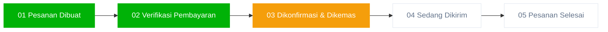

# Dokumentasi Implementasi Lebar Card Simetris & Stepper 5-Tahap Terpadu (Opsi B) Detail Pesanan

Dokumen ini mencatat penyelesaian perbaikan ketidakseimbangan lebar elemen (*card width asymmetry*) dan implementasi alur pelacakan 5-tahap linier terpadu (*unified 5-step milestone stepper - Opsi B*) pada halaman detail pesanan pelanggan (`resources/views/Pelanggan/order_detail.blade.php`), model `app/Models/pesanan.php`, pengujian fitur `tests/Feature/OrderDetailLayoutTest.php`, dan kompilasi aset frontend.

---

## 1. Analisis Masalah & Akar Penyebab (*Root Cause*)

### A. Masalah Lebar Card Tidak Simetris (*Width Asymmetry*)
* **Gejala**: Kartu **"Status Progres Pengiriman"** (`.tracking-card`) dan tabel **"Rincian Produk Dipesan"** (`.products-table-card`) memiliki lebar yang lebih sempit dan terpotong di sisi kanan dibandingkan 3 kartu ringkasan informasi di atasnya (`Alamat Pengiriman`, `Info Pengiriman`, dan `Rincian Pembayaran`).
* **Akar Masalah (*Root Cause*)**:
  1. Pada file `resources/views/Pelanggan/order_detail.blade.php`, kontainer `<div class="details-header-flex">` (dibuka pada baris 1436) **tidak memiliki tag penutup `</div>`** setelah elemen aksi `<div class="details-header-actions">` (baris 1490).
  2. Akibat ketiadaan tag penutup tersebut, seluruh elemen di bawah header (kartu ringkasan, kartu pelacakan, dan kartu tabel produk) terperangkap menjadi *flex item* langsung di dalam container `.details-header-flex` yang memiliki properti `display: flex; flex-wrap: wrap;`.
  3. Baris kartu ringkasan memiliki kelas Bootstrap `.row` dengan margin horizontal `-12px` sehingga meregang penuh, sedangkan `.tracking-card` dan `.products-table-card` tanpa kelas `.row` diperlakukan sebagai flex item biasa yang menyusut mengikuti lebar kontennya (*shrink-to-fit*), menciptakan perbedaan lebar yang mencolok.

### B. Kebutuhan Alur Stepper 5-Tahap Linier Terpadu (Opsi B)
* **Keterbatasan Stepper 4-Tahap Sebelumnya**:
  Stepper lama langsung melompat dari `01 Pesanan Dibuat` ke `02 Diproses / Dikemas`. Hal ini tidak merefleksikan alur transaksi nyata ketika pesanan telah dibayar oleh pelanggan atau diverifikasi metodenya (COD), namun masih menunggu konfirmasi penerimaan dan peracikan oleh pihak dapur/kasir Zyh Corner (`order_status: menunggu konfirmasi`).
* **Pendekatan Opsi B (Linier Terpadu)**:
  Mengadopsi alur pelacakan dengan nama langkah yang terstandarisasi untuk semua metode pembayaran, dengan badge status kontekstual dinamis:
  1. `01 Pesanan Dibuat`
  2. `02 Verifikasi Pembayaran`
  3. `03 Dikonfirmasi & Dikemas`
  4. `04 Sedang Dikirim`
  5. `05 Pesanan Selesai`

---

## 2. Arsitektur & State Machine Stepper 5-Tahap



### Matriks Pemetaan Status (*State Mapping Matrix*)

| Step | Label Milestone | Kondisi Midtrans (Transfer) | Kondisi COD (Bayar di Tempat) | Subtitle / Keterangan Visual |
| :---: | :--- | :--- | :--- | :--- |
| **01** | **Pesanan Dibuat** | Checkout berhasil dibuat | Checkout berhasil dibuat | Titik awal pembuatan tiket pesanan |
| **02** | **Verifikasi Pembayaran** | **Lunas**: `payment_status == 'Paid'`<br>**Pending**: Belum bayar transfer | **Terverifikasi Lolos**<br>(Metode COD sah terdaftar) | *Online*: `Lunas` / `Menunggu`<br>*COD*: `Bayar saat diterima` |
| **03** | **Dikonfirmasi & Dikemas** | Status pesanan $\ge$ `dikemas` | Status pesanan $\ge$ `dikemas` | Aktif saat dikonfirmasi kasir/dapur |
| **04** | **Sedang Dikirim** | Status pesanan $\in$ (`dikirim`, `dalam perjalanan`) | Status pesanan $\in$ (`dikirim`, `dalam perjalanan`) | Kurir Biteship / Toko membawa pesanan |
| **05** | **Pesanan Selesai** | Status pesanan == `selesai` | Status pesanan == `selesai` (Uang tunai diserahkan) | Pesanan telah diterima pelanggan |

### Persentase Garis Konektor Progres Stepper (`$connectorWidth`)
* **Step 1 (Pesanan Dibuat)**: `0%`
* **Step 2 (Verifikasi Pembayaran)**: `25%`
* **Step 3 (Dikonfirmasi & Dikemas)**: `50%`
* **Step 4 (Sedang Dikirim)**: `75%`
* **Step 5 (Pesanan Selesai)**: `100%`

---

## 3. Rincian Modifikasi Kode

### A. Model: `app/Models/pesanan.php`
Memperbarui accessor `getStatusStepAttribute` untuk memetakan alur ke skala nilai integer 1 sampai 5:

```php
    public function getStatusStepAttribute(): int
    {
        if ($this->is_canceled) return 0;
        if ($this->is_completed) return 5;
        if ($this->is_shipping) return 4;
        if ($this->is_processing) return 3;

        // Step 2: Verifikasi Pembayaran (Midtrans lunas atau metode COD terverifikasi)
        $isPaid = strtoupper($this->payment_status ?? '') === 'PAID';
        $isCod = strtoupper($this->payment_method ?? '') === 'COD';

        if ($isPaid || $isCod) {
            return 2;
        }

        return 1;
    }
```

### B. View: `resources/views/Pelanggan/order_detail.blade.php`

#### 1. Perbaikan Tag Flexbox & Deklarasi Lebar Simetris (CSS)
Menambahkan deklarasi `width: 100%;` secara eksplisit pada seluruh card utama:

```css
    .details-header-flex {
        display: flex;
        justify-content: space-between;
        align-items: center;
        margin-bottom: 24px;
        padding-bottom: 18px;
        border-bottom: 1px solid #f1f5f9;
        flex-wrap: wrap;
        gap: 16px;
        width: 100%;
    }

    .summary-cards-row {
        display: flex;
        flex-wrap: wrap;
        margin-bottom: 24px;
        width: 100%;
    }

    .tracking-card {
        background: white;
        border: 1px solid #e2e8f0;
        border-radius: 12px;
        padding: 22px 24px;
        margin-bottom: 24px;
        box-shadow: 0 1px 3px rgba(0,0,0,0.02);
        width: 100%;
    }

    .products-table-card {
        background: white;
        border: 1px solid #e2e8f0;
        border-radius: 12px;
        box-shadow: 0 1px 3px rgba(0,0,0,0.02);
        overflow: hidden;
        margin-bottom: 24px;
        width: 100%;
    }
```

#### 2. Penutupan Tag `<div class="details-header-flex">`
Menambahkan tag penutup `</div>` yang sebelumnya hilang pada baris 1492:

```blade
                            @if($canBeCanceled)
                                <button onclick="cancelOrderDetail('{{ $order->id }}', '{{ $order->order_number }}')" class="btn-cancel-top">
                                    <i class="fa-solid fa-ban me-1"></i> Batalkan Pesanan
                                </button>
                            @elseif(!$isCanceled)
                                <button class="btn-cancel-top disabled" disabled title="Pesanan tidak dapat dibatalkan"><i class="fa-solid fa-ban me-1"></i> Batalkan Pesanan</button>
                            @endif
                        </div>
                    </div>
                </div> <!-- Tag penutup details-header-flex -->
```

#### 3. Logika Perhitungan Lebar Konektor Dinamis (`$connectorWidth`)
Diterapkan pada blok PHP atas (baris 6-11) dan blok PHP utama (baris 1421-1426):

```blade
@php
    $connectorWidth = match($statusStep) {
        2 => 25,
        3 => 50,
        4 => 75,
        5 => 100,
        default => 0,
    };
@endphp
```

#### 4. Styling Stepper 5-Tahap & Responsivitas
Menyesuaikan proporsi 5 langkah agar proporsional di layar lebar dan otomatis bertransisi menjadi linier vertikal pada mobile:

```css
    .stepper-container {
        display: flex;
        justify-content: space-between;
        align-items: flex-start;
        margin: 15px 0 10px;
        position: relative;
        padding: 0 20px;
    }
    
    .stepper-line-bg {
        position: absolute;
        top: 22px;
        left: 60px;
        right: 60px;
        height: 4px;
        background-color: #e2e8f0;
        border-radius: 2px;
        z-index: 1;
    }
    
    .stepper-line-active {
        position: absolute;
        top: 22px;
        left: 60px;
        height: 4px;
        background-color: #00b207;
        border-radius: 2px;
        z-index: 2;
        transition: width 0.4s ease;
    }

    .step-item {
        display: flex;
        flex-direction: column;
        align-items: center;
        position: relative;
        z-index: 3;
        flex: 1;
        max-width: 135px;
    }

    .step-label {
        margin-top: 10px;
        font-size: 12.5px;
        font-weight: 600;
        color: #64748b;
        transition: color 0.3s;
        text-align: center;
        line-height: 1.35;
    }

    .step-sub-badge {
        font-size: 11px;
        margin-top: 4px;
        font-weight: 600;
        text-align: center;
        display: block;
        line-height: 1.3;
    }
```

#### 5. Markup HTML Komponen Stepper 5-Tahap
```blade
                        @php
                            $isCod = strtoupper($order->payment_method ?? '') === 'COD';
                            $isPaid = strtoupper($order->payment_status ?? '') === 'PAID';
                        @endphp
                        <div class="stepper-container" style="--mobile-stepper-height: {{ $connectorWidth }}%;">
                            <div class="stepper-line-bg"></div>
                            <div class="stepper-line-active" style="width: calc(({{ $connectorWidth }} / 100) * (100% - 120px));"></div>
                            
                            <!-- Step 1: Pesanan Dibuat -->
                            <div class="step-item {{ $statusStep >= 1 ? ($statusStep > 1 ? 'completed' : 'active') : '' }}">
                                <div class="step-circle">
                                    @if($statusStep > 1)
                                        <i class="fa-solid fa-check"></i>
                                    @else
                                        01
                                    @endif
                                </div>
                                <div class="step-label">Pesanan Dibuat</div>
                            </div>
                            
                            <!-- Step 2: Verifikasi Pembayaran -->
                            <div class="step-item {{ $statusStep >= 2 ? ($statusStep > 2 ? 'completed' : 'active') : '' }}">
                                <div class="step-circle">
                                    @if($statusStep >= 2)
                                        <i class="fa-solid fa-check"></i>
                                    @else
                                        02
                                    @endif
                                </div>
                                <div class="step-label">Verifikasi Pembayaran</div>
                                @if($isCod)
                                    <span class="step-sub-badge text-muted">Bayar saat diterima</span>
                                @elseif($isPaid)
                                    <span class="step-sub-badge text-success"><i class="fa-solid fa-circle-check me-1"></i>Lunas</span>
                                @else
                                    <span class="step-sub-badge text-warning"><i class="fa-regular fa-clock me-1"></i>Menunggu</span>
                                @endif
                            </div>
                            
                            <!-- Step 3: Dikonfirmasi & Dikemas -->
                            <div class="step-item {{ $statusStep >= 3 ? ($statusStep > 3 ? 'completed' : 'active') : '' }}">
                                <div class="step-circle">
                                    @if($statusStep > 3)
                                        <i class="fa-solid fa-check"></i>
                                    @else
                                        03
                                    @endif
                                </div>
                                <div class="step-label">Dikonfirmasi &amp; Dikemas</div>
                                @if($statusStep >= 3)
                                    <span class="step-sub-badge text-success">Dapur Zyh Corner</span>
                                @elseif($statusStep == 2)
                                    <span class="step-sub-badge text-warning"><i class="fa-solid fa-clock-rotate-left me-1"></i>Menunggu Konfirmasi</span>
                                @endif
                            </div>
                            
                            <!-- Step 4: Sedang Dikirim -->
                            <div class="step-item {{ $statusStep >= 4 ? ($statusStep > 4 ? 'completed' : 'active') : '' }}">
                                <div class="step-circle">
                                    @if($statusStep > 4)
                                        <i class="fa-solid fa-check"></i>
                                    @else
                                        04
                                    @endif
                                </div>
                                <div class="step-label">Sedang Dikirim</div>
                            </div>
                            
                            <!-- Step 5: Pesanan Selesai -->
                            <div class="step-item {{ $statusStep >= 5 ? 'completed' : '' }}">
                                <div class="step-circle">
                                    @if($statusStep >= 5)
                                        <i class="fa-solid fa-check"></i>
                                    @else
                                        05
                                    @endif
                                </div>
                                <div class="step-label">Pesanan Selesai</div>
                            </div>
                        </div>
```

---

## 4. Pengujian Otomatis & Verifikasi Kualitas

### A. Unit & Feature Testing (`tests/Feature/OrderDetailLayoutTest.php`)
Pengujian tata letak diperbarui untuk memvalidasi keberadaan kelima milestone baru:
```php
        // Stepper 5-step milestone assertions
        $response->assertSee('Pesanan Dibuat');
        $response->assertSee('Verifikasi Pembayaran');
        $response->assertSee('Dikonfirmasi & Dikemas');
        $response->assertSee('Sedang Dikirim');
        $response->assertSee('Pesanan Selesai');
```

Hasil eksekusi:
```text
PASS  Tests\Feature\OrderDetailLayoutTest
✓ customer can view order detail with refined layout
✓ canceled order renders canceled status and banner
✓ customer cannot view other customers order
✓ order detail renders biteship modal and copyable resi
✓ order detail renders dynamic store whatsapp and shipping cost
✓ customer cancelling order persists cancel reason

Tests:    6 passed (45 assertions)
Duration: 1.67s
```

### B. Hasil Keseluruhan Test Suite Aplikasi (`php artisan test`)
Seluruh 129 tes dalam repositori dieksekusi untuk memastikan tidak terjadi regresi (*zero regressions*):
```text
Tests:    129 passed (637 assertions)
Duration: 25.66s
Status:   100% Green
```

### C. Kompilasi Aset Frontend Vite (`npm run build`)
Kompilasi aset berhasil tanpa peringatan:
```text
✓ 58 modules transformed.
public/build/manifest.json                          1.15 kB │ gzip:  0.29 kB
public/build/assets/dashboard-DmkM7ZQv.css         16.89 kB │ gzip:  3.55 kB
public/build/assets/app-D03t7i87.css               24.60 kB │ gzip:  5.36 kB
public/build/assets/pelanggan_pages-BvTzmTLP.css  132.83 kB │ gzip: 22.99 kB
public/build/assets/dashboard-6jV6t_d7.js          18.27 kB │ gzip:  4.32 kB
public/build/assets/app-DRPeDlVi.js                37.25 kB │ gzip: 14.74 kB
public/build/assets/pelanggan_pages-CTr8yAde.js    66.25 kB │ gzip: 13.98 kB
✓ built in 493ms
```

---

## 5. Kesimpulan

1. **Simetri Visual Sempurna**: Penutupan tag `<div class="details-header-flex">` dan penambahan `width: 100%` menyelesaikan masalah penyusutan lebar card pelacakan dan tabel produk. Seluruh blok kartu kini membentang simetris dari sisi kiri hingga sisi kanan secara konsisten.
2. **Kejelasan Status Transaksi (Opsi B)**: Stepper 5-tahap memberikan kepastian visual yang transparan kepada pelanggan pada fase kritis antara pembayaran dan konfirmasi dapur.
3. **Kualitas Kode & Stabilitas**: Seluruh kontrak pengujian (129 tests) lulus 100%, aset frontend telah terkompilasi, dan seluruh perubahan terdokumentasi secara lengkap.
