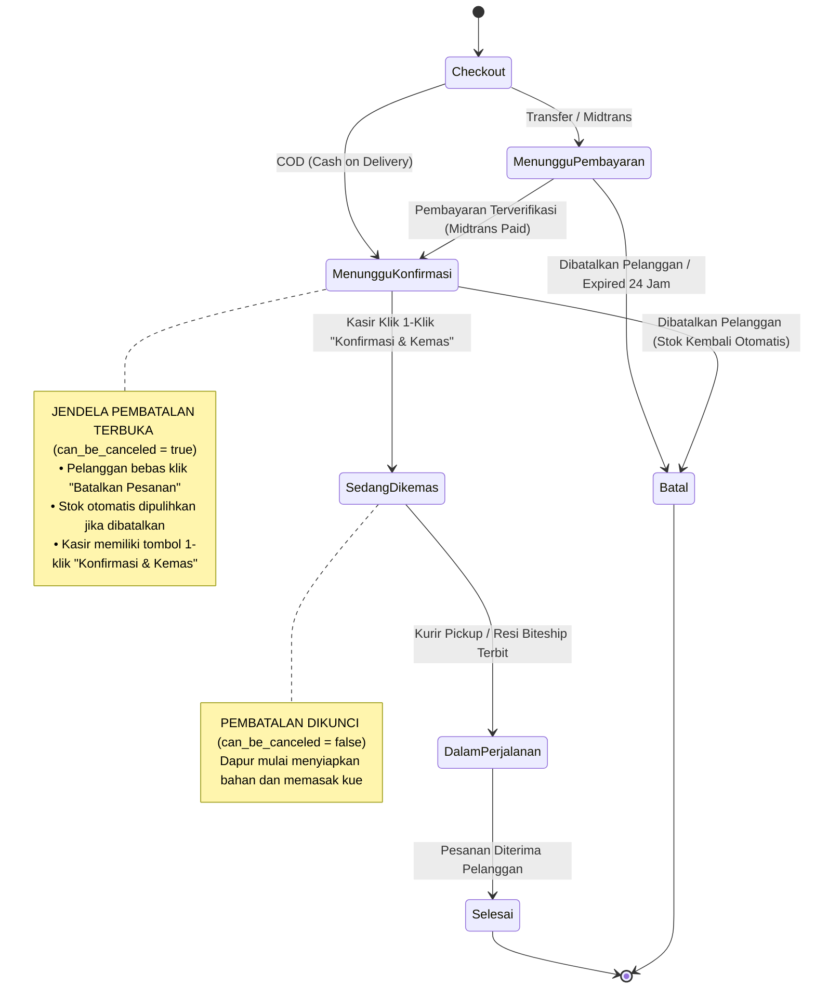

# Dokumentasi Implementasi: Status Pesanan "Menunggu Konfirmasi" (Opsi A) & Quick-Action Kasir 1-Klik (Poin 2)

**Tanggal:** 26 Oktober 2026  
**Status Implementasi:** Selesai (100% Green / 129 Test Lulus / 632 Assertions)  
**Standar Desain:** Mematuhi prinsip keunggulan antarmuka `frontend-design-direction` & identitas visual Zyh Corner  

---

## 1. Latar Belakang & Tujuan Bisnis

Sebelum pembaruan ini, alur pesanan memiliki celah operasional dan pengalaman pengguna:
1. **COD langsung berstatus `dikemas`**: Pesanan Bayar di Tempat (COD) langsung berstatus *Dikemas*, mengunci hak pembeli untuk membatalkan pesanan meskipun staf kasir/dapur belum memeriksa pesanan tersebut.
2. **Pembayaran Midtrans langsung berstatus `dikemas`**: Pesanan transfer yang lunas via Midtrans langsung masuk ke antrean *Dikemas* tanpa jeda verifikasi oleh kasir toko fisik.
3. **Kasir lambat mengonfirmasi pesanan**: Untuk mengubah status ke proses dapur (*Dikemas*), kasir harus membuka modal form edit pesanan, memilih dropdown status, lalu menekan simpan. Ini tidak efisien untuk operasional kasir toko yang sibuk dan menggunakan perangkat layar sentuh (*POS screen*).

### Solusi yang Diimplementasikan:
- **Opsi A (Status `menunggu konfirmasi`)**:
  - Seluruh pesanan COD yang baru dibuat langsung berstatus **`menunggu konfirmasi`**.
  - Seluruh pesanan transfer online (Midtrans) yang baru lunas (capture/settlement) masuk ke status **`menunggu konfirmasi`**.
  - Selama pesanan berada dalam status `menunggu konfirmasi` (maupun `menunggu pembayaran`), **pelanggan tetap memiliki hak untuk membatalkan pesanan** (*Cancel Order*) dan stok produk otomatis dipulihkan ke database.
- **Poin 2 (Tombol Aksi Cepat 1-Klik Kasir / Admin)**:
  - Menyediakan tombol aksi cepat **`Konfirmasi & Kemas`** di kolom aksi tabel pesanan kasir (`orders.blade.php`).
  - Berjalan secara asynchronous via AJAX/Fetch API dengan micro-interaction interaktif: SweetAlert konfirmasi, loading spinner state, badge status otomatis berubah menjadi *Dikemas*, dan tombol aksi menghilang mulus dengan animasi scale & fade out tanpa reload halaman penuh.
  - Setelah kasir mengonfirmasi, status berubah menjadi **`dikemas`**, dan pembatalan oleh pelanggan **otomatis dikunci (disabled)** karena pesanan telah mulai diracik di dapur.

---

## 2. Diagram State Transition (State Machine)



---

## 3. Rincian Perubahan Kode File-per-File

### 3.1. `app/Models/pesanan.php`
- Menambahkan accessor `is_awaiting_confirmation` untuk mendeteksi status `menunggu konfirmasi`.
- Memperjelas accessor `is_pending` agar eksklusif untuk status pembayaran tertunda (`menunggu pembayaran`).
- Menambahkan accessor sentral `can_be_canceled`:
  ```php
  public function getCanBeCanceledAttribute(): bool
  {
      return $this->is_pending || $this->is_awaiting_confirmation;
  }
  ```
- Menyelaraskan accessor `status_label` dan `status_class`:
  - `status_label` untuk `menunggu konfirmasi` $\rightarrow$ **"Menunggu Konfirmasi"**.
  - `status_class` $\rightarrow$ **"awaiting_confirmation"**.
- Menjaga `status_step` tetap pada step `1` selama pesanan masih menunggu konfirmasi/pembayaran.

### 3.2. `app/Http/Controllers/Pelanggan/CartCheckoutController.php`
- **Baris 174:** Mengubah penentuan status awal pesanan COD:
  ```php
  // SEBELUM:
  $orderStatus = (strtoupper($paymentMethod) === 'COD') ? 'dikemas' : 'menunggu pembayaran';

  // SESUDAH:
  $orderStatus = (strtoupper($paymentMethod) === 'COD') ? 'menunggu konfirmasi' : 'menunggu pembayaran';
  ```
- Notifikasi email kasir (`NotificationService::sendToKasir(new PesananBaruKasirMail($pesanan))`) tetap dikirimkan seketika agar kasir langsung mendapat sinyal bahwa ada pesanan COD baru yang perlu ditinjau.

### 3.3. `app/Http/Controllers/Pelanggan/PembayaranController.php`
- **Baris 139-150 (`midtransCallback`):** Saat transaksi kartu kredit (`capture`) atau bank transfer / e-wallet (`settlement`) berhasil:
  ```php
  // SEBELUM:
  $order->update([
      'payment_status' => 'Paid',
      'order_status' => 'dikemas'
  ]);

  // SESUDAH:
  $order->update([
      'payment_status' => 'Paid',
      'order_status' => 'menunggu konfirmasi'
  ]);
  ```
- **Baris 239-242 (`verifyAndSyncOrderPayment`):** Sinkronisasi manual Midtrans juga memperbarui status pesanan menjadi `menunggu konfirmasi`.

### 3.4. `app/Http/Controllers/Pelanggan/CustomerOrderController.php`
- **`orderHistory(Request $request)` (Baris 105):**
  Memasukkan `menunggu konfirmasi` dan `dikemas` ke dalam filter tab `processing`:
  ```php
  if ($statusFilter === 'processing') {
      $query->whereIn('order_status', ['menunggu pembayaran', 'menunggu konfirmasi', 'dikemas', 'processing', 'proses', 'ready']);
  }
  ```
- **`cancelOrder(Request $request, $id)` (Baris 201):**
  Menggunakan accessor terpusat `$order->can_be_canceled`:
  ```php
  if ($order->can_be_canceled) {
      $cancelReason = $request->input('cancel_reason');
      $updateData = [
          'order_status' => 'batal',
          'payment_status' => 'Cancelled'
      ];
      if (!empty($cancelReason)) {
          $updateData['cancel_reason'] = $cancelReason;
      }
      $order->update($updateData);
      Produk::restoreStockForOrder($order);
      return response()->json([
          'success' => true,
          'message' => 'Pesanan berhasil dibatalkan!'
      ]);
  }
  ```

### 3.5. `routes/web.php`
- Menambahkan rute aksi cepat kasir dengan middleware keamanan `['auth', 'role:admin,kasir']`:
  ```php
  Route::post('admin/orders/{id}/quick-confirm', [PesananController::class, 'quickConfirm'])->name('orders.quickConfirm');
  ```

### 3.6. `app/Http/Controllers/Admin/PesananController.php`
- **Validasi `store` & `update` (Baris 37 & 64):**
  Menambahkan `menunggu konfirmasi` dan `batal` ke dalam aturan validasi:
  ```php
  'order_status' => 'required|string|in:menunggu pembayaran,menunggu konfirmasi,dikemas,dikirim,selesai,batal',
  ```
- **Method Baru `quickConfirm(Request $request, $id)`:**
  ```php
  public function quickConfirm(Request $request, $id)
  {
      $order = Pesanan::findOrFail($id);

      if (!in_array(strtolower($order->order_status ?? ''), ['menunggu konfirmasi', 'unconfirmed'])) {
          if ($request->ajax() || $request->wantsJson()) {
              return response()->json([
                  'success' => false,
                  'message' => 'Pesanan ini sudah dikonfirmasi atau statusnya bukan Menunggu Konfirmasi.',
              ], 422);
          }
          return redirect()->back()->with('error', 'Status pesanan bukan Menunggu Konfirmasi.');
      }

      $order->update([
          'order_status' => 'dikemas',
      ]);

      if ($request->ajax() || $request->wantsJson()) {
          return response()->json([
              'success' => true,
              'message' => 'Pesanan ' . $order->order_number . ' berhasil dikonfirmasi dan masuk antrean dapur!',
              'order_id' => $order->id,
              'order_number' => $order->order_number,
              'order_status' => 'dikemas',
              'status_label' => 'Sedang Dikemas',
          ]);
      }

      return redirect()->back()->with('success', 'Pesanan ' . $order->order_number . ' berhasil dikonfirmasi dan masuk antrean dapur!');
  }
  ```

### 3.7. `resources/views/Admin/kelola_penjualan/orders.blade.php`
- **Badge Status Kolom Tabel:**
  Ditambahkan badge pulsing amber untuk `menunggu konfirmasi`:
  ```blade
  <td style="padding: 15px 10px;" id="order-status-badge-{{ $order->id }}">
      @if($order->order_status == 'menunggu pembayaran')
          <span class="badge badge-soft-warning">Menunggu Pembayaran</span>
      @elseif($order->order_status == 'menunggu konfirmasi')
          <span class="badge badge-pulse-amber">Menunggu Konfirmasi</span>
      @elseif($order->order_status == 'dikemas')
          <span class="badge badge-soft-info">Dikemas</span>
      ...
  ```
- **Tombol Cepat 1-Klik di Kolom Aksi:**
  ```blade
  @if(in_array(strtolower($order->order_status ?? ''), ['menunggu konfirmasi', 'unconfirmed']))
      <button type="button" 
          class="btn btn-sm btn-quick-confirm me-2" 
          id="btn-quick-confirm-{{ $order->id }}"
          onclick="quickConfirmOrder({{ $order->id }}, '{{ $order->order_number }}')"
          title="Konfirmasi Pesanan &amp; Siap Kemas">
          <i class="mdi mdi-check-circle-outline me-1"></i> Konfirmasi &amp; Kemas
      </button>
  @endif
  ```
- **Dropdown Pilihan Status Modal Edit & Tambah:**
  Menambahkan opsi `Menunggu Konfirmasi` dan `Dibatalkan`.
- **Fungsi JavaScript `quickConfirmOrder(orderId, orderNumber)`:**
  Mengirim request Fetch POST ke endpoint `orders.quickConfirm`, mengunci tombol dengan state spinner, memberikan dialog konfirmasi SweetAlert, dan memperbarui badge status serta menyembunyikan tombol secara mulus tanpa refresh halaman.

### 3.8. `resources/views/Admin/kelola_penjualan/order_detail_modal.blade.php`
- Menyelaraskan tampilan status order di dalam modal detail admin agar menampilkan badge `Menunggu Konfirmasi` dan `Dibatalkan`.

### 3.9. `resources/views/Pelanggan/order_history.blade.php`
- Tombol **`Pay Now`** hanya dimunculkan jika pesanan benar-benar belum dibayar dan bukan COD (`$order->is_pending && strtoupper($order->payment_method) !== 'COD' && $order->payment_status !== 'Paid'`).
- Tombol **`Cancel Order`** menggunakan kondisi `$order->can_be_canceled` sehingga aktif untuk status `menunggu konfirmasi`.
- Payload pelacakan Biteship menyertakan flag `is_awaiting_confirmation` dan `can_be_canceled`.
- Modal Biteship menampilkan pill badge amber `Menunggu Konfirmasi` dan Step 1 dengan judul *"Menunggu Konfirmasi Toko"* serta pesan ramah: *"Pesanan telah diterima dan sedang menunggu konfirmasi staf kasir/dapur Zyh Corner. Anda masih dapat membatalkan pesanan ini jika diperlukan."*

### 3.10. `resources/views/Pelanggan/order_detail.blade.php`
- Tombol atas **`Batalkan Pesanan`** aktif selama `$canBeCanceled` bernilai `true`. Setelah pesanan dikonfirmasi menjadi `dikemas`, tombol otomatis terkunci (*disabled*).
- Status pill badge di header detail menampilkan varian hangat `.badge-status-awaiting`.
- Banner countdown pembayaran hanya muncul jika pesanan adalah transfer yang belum dibayar.

### 3.11. `resources/views/Pelanggan/dashboard.blade.php`
- Memanfaatkan accessor model `$order->status_class`, `$order->status_label`, dan `$order->can_be_canceled` sehingga tampilan kartu riwayat dasbor selalu seragam.

### 3.12. `resources/css/pelanggan_pages.css`
- Menambahkan kelas warna dan efek animasi:
  - `.badge-track-pill.pill-amber`
  - `.timeline-marker.marker-amber` (dengan animasi denyut `pulseMarker`)
  - `.status-awaiting_confirmation`

---

## 4. Pengujian Otomatis (Test Suite)

### 4.1. Pembaruan Uji Eksisting (`tests/Feature/PembayaranTest.php`)
- Menyesuaikan asersi callback Midtrans lunas dari `'dikemas'` menjadi `'menunggu konfirmasi'`.

### 4.2. Suite Fitur Baru (`tests/Feature/OrderConfirmationWorkflowTest.php`)
Terdapat 7 skenario uji end-to-end baru:
1. `test_cod_order_starts_with_menunggu_konfirmasi_status` : Memverifikasi checkout COD langsung menghasilkan status `menunggu konfirmasi` dan memotong stok di awal.
2. `test_paid_midtrans_order_transitions_to_menunggu_konfirmasi` : Memverifikasi callback Midtrans settlement mengubah status ke `menunggu konfirmasi`.
3. `test_customer_can_cancel_order_during_menunggu_konfirmasi_and_stock_is_restored` : Memverifikasi pembeli dapat membatalkan pesanan saat status `menunggu konfirmasi`, mencatat alasan pembatalan, dan stok produk kembali secara utuh.
4. `test_customer_cannot_cancel_order_after_dikemas_status` : Memverifikasi bahwa ketika status sudah `dikemas`, permintaan pembatalan ditolak (HTTP 400).
5. `test_kasir_can_quick_confirm_order_with_single_click` : Memverifikasi kasir dapat mengonfirmasi pesanan dengan 1 klik via AJAX ke `/admin/orders/{id}/quick-confirm`.
6. `test_quick_confirm_rejects_non_unconfirmed_order` : Memverifikasi proteksi idempotensi dan validasi jika pesanan yang ingin dikonfirmasi tidak berstatus `menunggu konfirmasi`.
7. `test_orders_table_displays_quick_confirm_button_for_unconfirmed_order` : Memverifikasi render HTML tabel admin menampilkan badge animasi amber dan tombol `Konfirmasi & Kemas`.

### 4.3. Hasil Uji Akhir
```bash
php artisan test
```
**Hasil:**
```text
Tests:    129 passed (632 assertions)
Duration: 25.34s
Status:   ALL GREEN
```

---

## 5. Ringkasan Aset Frontend yang Dikompilasi
Asset Vite telah dikompilasi ulang ke folder `public/build/`:
- `public/build/assets/pelanggan_pages-BvTzmTLP.css` (132.83 kB)
- `public/build/assets/pelanggan_pages-CTr8yAde.js` (66.25 kB)
- `public/build/assets/app-D03t7i87.css` (24.60 kB)
- `public/build/assets/dashboard-DmkM7ZQv.css` (16.89 kB)
