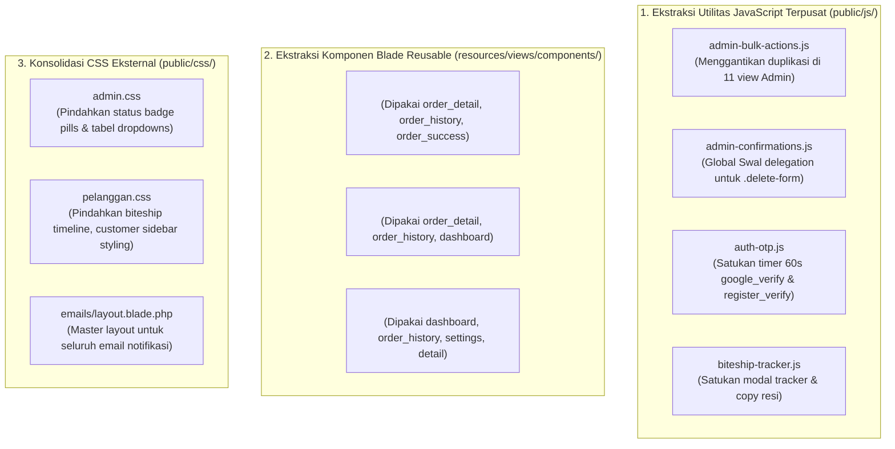

# Laporan Audit & Analisis Reusabilitas Kode CSS dan JavaScript pada Views

## 1. Ringkasan Eksekutif & Statistik Global

Audit ini memeriksa seluruh berkas Blade view dalam direktori `resources/views/` (total **51 berkas**) untuk mengidentifikasi keberadaan kode CSS (`<style>`, inline `style="..."`) dan JavaScript (`<script>`, inline handlers), serta mengklasifikasikannya ke dalam kelompok **Reusable (Dapat Didaur Ulang / Komponenisasi)** versus **Non-Reusable (Spesifik Halaman / Bespoke)**.

### Ringkasan Statistik
- **Total Berkas Blade**: 51 berkas
- **Views dengan Blok `<style>` Internal**: 23 berkas (~3.766 baris CSS tertanam)
- **Views dengan Blok `<script>` Internal (>5 baris)**: 38 berkas (~4.120 baris JS tertanam)
- **Views dengan Penggunaan Atribut `style="..."` Berat (>20 inline styles)**: 28 berkas
- **Temuan Duplikasi Kritis**: Ditemukan duplikasi kode JavaScript hingga 11 berkas untuk fitur aksi massal (*bulk delete*), duplikasi modal pelacakan dan bukti bayar di 3 halaman riwayat transaksi pelanggan, serta duplikasi 100% kode CSS/JS pada halaman verifikasi OTP.

---

## 2. Klasifikasi Kode Reusable (Dapat Didaur Ulang / Komponenisasi)

Kode dalam kategori ini memiliki pola yang berulang di banyak halaman atau menangani use-case umum yang dapat diekstraksi ke berkas eksternal (`public/js/`, `public/css/`) atau komponen Blade (`resources/views/components/`).

### A. Pola JavaScript Reusable

#### 1. Manajemen Aksi Massal (*Bulk Delete Checkbox & SweetAlert2*)
- **Lokasi Ditemukan (11 Views)**:
  - `resources/views/Admin/kelola_akun/cassiers.blade.php` (baris 259–323)
  - `resources/views/Admin/kelola_akun/customers.blade.php` (baris 270–342)
  - `resources/views/Admin/kelola_produk/products.blade.php` (baris 240–311)
  - `resources/views/Admin/kelola_produk/categories.blade.php` (baris 181–245)
  - `resources/views/Admin/kelola_produk/custom_products.blade.php` (baris 223–294)
  - `resources/views/Admin/kelola_produk/discounts.blade.php` (baris 700–770)
  - `resources/views/Admin/kelola_produk/expired_products.blade.php` (baris 341–418)
  - `resources/views/Admin/kelola_penjualan/orders.blade.php` (baris 372–440)
  - `resources/views/Admin/kelola_penjualan/returs.blade.php` (baris 629–700)
  - `resources/views/Admin/pesan_kontak/index.blade.php` (baris 383–450)
  - `resources/views/Admin/kelola_carousel/banners.blade.php` (baris 850–915)
- **Mekanisme Logika**:
  - `checkAll` checkbox listener yang mencentang semua `.row-checkbox`.
  - Fungsi `updateBulkDeleteState()` yang menghitung jumlah checkbox terpilih dan menampilkan badge `selectedCountSpan`.
  - Mengubah visibilitas tombol `#btnBulkDelete` (`d-none` / `d-inline-flex`).
  - SweetAlert2 konfirmasi: `"Apakah Anda yakin ingin menghapus {count} data terpilih?"`.
  - Pengisian dinamis `<input type="hidden" name="ids[]" value="...">` ke form `#bulkDeleteForm` sebelum submit.
- **Rekomendasi Solusi**: Ekstraksi menjadi satu berkas `public/js/admin-bulk-actions.js` yang bekerja deklaratif berbasis atribut HTML (`data-bulk-table`, `data-bulk-checkbox`, `data-bulk-submit`).

---

#### 2. Konfirmasi Hapus Data Tunggal (*Single Delete Form via SweetAlert2*)
- **Lokasi Ditemukan (16 Views)**:
  - Seluruh view tabel Admin (`cassiers`, `customers`, `products`, `categories`, `orders`, `returs`, `banners`, `discounts`, `expired_products`, `contact_messages`, dsb.)
- **Mekanisme Logika**:
  ```javascript
  document.querySelectorAll('.delete-form').forEach(form => {
      form.addEventListener('submit', function(e) {
          e.preventDefault();
          Swal.fire({
              title: 'Apakah Anda yakin?',
              text: "Data yang dihapus tidak dapat dikembalikan!",
              icon: 'warning',
              showCancelButton: true,
              confirmButtonColor: '#00B207',
              cancelButtonColor: '#d33',
              confirmButtonText: 'Ya, hapus!',
              cancelButtonText: 'Batal'
          }).then((result) => { if (result.isConfirmed) form.submit(); });
      });
  });
  ```
- **Rekomendasi Solusi**: Pasang event delegation global di `layout_pAdmin.blade.php` atau `PurpleAdmin/assets/js/misc.js` yang menangani semua form berkelas `.delete-form` atau tombol beratribut `data-confirm-delete`.

---

#### 3. Modal Pelacakan Ekspedisi Biteship (*Tracking Modal & Resi Clipboard*)
- **Lokasi Ditemukan (4 Views)**:
  - `resources/views/Pelanggan/order_detail.blade.php` (baris 2735–2820)
  - `resources/views/Pelanggan/order_history.blade.php` (baris 765–850)
  - `resources/views/Pelanggan/dashboard.blade.php` (baris 750–820)
  - `resources/views/Pelanggan/order_success.blade.php`
- **Mekanisme Logika**:
  - `openBiteshipTrackingModal()` / `openOrderHistoryTracking(data)` untuk render data tracking status kurir.
  - Normalisasi status Biteship, tanggal/waktu tracking timeline.
  - Fungsi salin nomor resi ke clipboard (`copyTrackingResi()`, `fallbackCopyResi()`, `showResiToast()`).
- **Rekomendasi Solusi**: Ekstraksi menjadi satu Blade Component `<x-biteship-tracking-modal />` dan file JavaScript terpusat `public/js/biteship-tracker.js`.

---

#### 4. Modal Unggah Bukti Transfer Bank (*Payment Proof Upload & Dropzone*)
- **Lokasi Ditemukan (3 Views)**:
  - `resources/views/Pelanggan/order_detail.blade.php` (baris 2825–2960)
  - `resources/views/Pelanggan/order_history.blade.php` (baris 610–755)
  - `resources/views/Pelanggan/order_success.blade.php` (baris 680–820)
- **Mekanisme Logika**:
  - Validasi berkas bukti bayar (ukuran maks 5MB, format JPG/PNG/WEBP).
  - Live preview thumbnail bukti pembayaran menggunakan `FileReader`.
  - Salin nomor rekening BCA ke clipboard dengan feedback visual.
  - Submit form bukti pembayaran melalui AJAX / FormData dengan indikator loading.
- **Rekomendasi Solusi**: Satukan struktur HTML modal ke dalam Blade Component `<x-payment-proof-modal />` dan skripnya ke `public/js/payment-proof-uploader.js`.

---

#### 5. Logika Countdown Timer OTP & Resend (*60-Second Persistence*)
- **Lokasi Ditemukan (2 Views - 100% Identik)**:
  - `resources/views/Auth/google_verify.blade.php` (baris 135–214)
  - `resources/views/Auth/register_verify.blade.php` (baris 135–214)
- **Mekanisme Logika**:
  - Countdown 60 detik berbasis `localStorage.getItem('otp_timer_end')` agar timer tidak reset saat halaman di-refresh.
  - Disable tombol resend selama timer berjalan, update teks `Kirim ulang dalam XXs`.
  - Masking dan auto-advance input digit OTP (hanya menerima karakter angka 0-9).
- **Rekomendasi Solusi**: Pindahkan ke `public/js/auth-otp.js`.

---

#### 6. Live Preview Unggah Gambar (*FileReader Input Preview*)
- **Lokasi Ditemukan (5 Views)**:
  - `resources/views/Admin/kelola_carousel/banners.blade.php`
  - `resources/views/Admin/kelola_produk/products_form.blade.php`
  - `resources/views/Pelanggan/settings.blade.php` (avatar)
  - `resources/views/Pelanggan/dashboard.blade.php` (avatar)
  - `resources/views/Pelanggan/order_detail.blade.php` (bukti bayar)
- **Mekanisme Logika**:
  ```javascript
  const reader = new FileReader();
  reader.onload = e => targetImg.src = e.target.result;
  reader.readAsDataURL(file);
  ```
- **Rekomendasi Solusi**: Buat helper utilitas `window.initImagePreview(inputEl, previewEl)` di berkas aset umum.

---

### B. Pola CSS Reusable

#### 1. Styling Kartu & Form Verifikasi OTP
- **Lokasi Ditemukan (2 Views - 100% Identik)**:
  - `resources/views/Auth/google_verify.blade.php` (baris 7–98)
  - `resources/views/Auth/register_verify.blade.php` (baris 7–98)
- **Isi Selektor (92 baris CSS)**:
  - `.otp-verify-card`, `.otp-verify-title`, `.otp-verify-subtitle`, `.otp-verify-email`, `.otp-code-input`, `.otp-code-input:focus`, `.otp-submit-btn`, `.resend-otp-btn`, `.otp-timer-badge`.
- **Rekomendasi Solusi**: Pindahkan seluruh blok CSS ke `public/css/auth.css`.

---

#### 2. Styling Status Badge & Action Pill Tabel Penjualan
- **Lokasi Ditemukan (4 Views Admin)**:
  - `resources/views/Admin/kelola_penjualan/orders.blade.php` (baris 10–74)
  - `resources/views/Admin/kelola_penjualan/returs.blade.php`
  - `resources/views/Admin/kelola_penjualan/sales_report.blade.php`
  - `resources/views/Admin/kelola_penjualan/all_sales.blade.php`
- **Isi Selektor**:
  - Badge status order: `.badge-menunggu`, `.badge-dikemas`, `.badge-dikirim`, `.badge-selesai`, `.badge-dibatalkan`.
  - Dropdown menu styling, border radius tabel, hover baris tabel.
- **Rekomendasi Solusi**: Pindahkan ke `public/css/admin.css` yang sudah di-load oleh `layout_pAdmin.blade.php`.

---

#### 3. Styling Modal Pelacakan Biteship & Timeline Kurir
- **Lokasi Ditemukan (2 Views)**:
  - `resources/views/Pelanggan/order_detail.blade.php` (baris 550–840, ~290 baris)
  - `resources/views/Pelanggan/order_history.blade.php` (baris 15–52)
- **Isi Selektor**:
  - `.biteship-modal-dialog`, `.biteship-timeline`, `.biteship-step`, `.biteship-step-icon`, `.biteship-resi-badge`, `.courier-info-box`.
- **Rekomendasi Solusi**: Pindahkan ke `public/css/pelanggan.css`.

---

#### 4. Styling Template Email Notifikasi Sistem
- **Lokasi Ditemukan (4 Views Email)**:
  - `resources/views/emails/pesanan_baru_kasir.blade.php`
  - `resources/views/emails/pesan_kontak_baru_admin.blade.php`
  - `resources/views/emails/produk_kadaluarsa_kasir.blade.php`
  - `resources/views/emails/retur_produk_kasir.blade.php`
- **Isi Selektor**:
  - `.email-card`, `.header`, `.body-content`, `.info-table`, `.info-table td.label`, `.info-table td.value`, `.btn-action`, `.footer`.
- **Rekomendasi Solusi**: Buat master layout email `resources/views/emails/layout.blade.php` agar gaya email terpusat dan konsisten.

---

#### 5. Komponen Sidebar Navigasi Dashboard Pelanggan
- **Lokasi Ditemukan (4 Views)**:
  - `resources/views/Pelanggan/dashboard.blade.php`
  - `resources/views/Pelanggan/order_history.blade.php`
  - `resources/views/Pelanggan/order_detail.blade.php`
  - `resources/views/Pelanggan/settings.blade.php`
- **Karakteristik**:
  - Struktur HTML kartu profil (avatar, nama, email) dan daftar link menu dengan penanda halaman aktif (`Dashboard`, `Pesanan Saya`, `Pengaturan`, `Alamat`).
- **Rekomendasi Solusi**: Ekstraksi menjadi Blade Component `<x-customer-sidebar active="orders" />` dan sentralisasi styling ke `public/css/pelanggan.css`.

---

## 3. Klasifikasi Kode Non-Reusable (Spesifik Halaman / Bespoke)

Kode dalam kategori ini memiliki keterikatan logika domain yang sangat tinggi terhadap satu fitur khusus, sehingga memindahkannya ke tempat umum justru akan mengotori namespace global atau membingungkan developer.

| Nama Berkas | Jenis | Estimasi Baris | Alasan Tidak Reusable (Bespoke) |
| :--- | :---: | :---: | :--- |
| **`Pelanggan/home.blade.php`** | CSS | 1.074 baris | Desain hero showcase 58% full-bleed, feathered spotlight melt, frosted glass slider arrows, dual-tone spotlight, dan layout 4 kolom yang hanya dipakai di beranda toko. |
| **`Pelanggan/checkout.blade.php`** | JS | 678 baris | Orkestrasi alur checkout: kaskade wilayah Biteship (Provinsi -> Kota -> Kecamatan -> Kelurahan), kalkulasi ongkir real-time API Biteship, integrasi pemilih titik koordinat Leaflet map/GPS, validasi kustom teks kue, dan payload order khusus checkout. |
| **`Admin/kelola_penjualan/pos.blade.php`** | JS / CSS | 248 baris JS, 44 baris CSS | Logika Point of Sale (POS) kasir offline: state array `window.cart`, integrasi barcode scanner listener, offcanvas keranjang kasir, tombol +/- kuantitas kasir, dan kalkulasi diskon langsung di kasir. |
| **`Admin/kelola_penjualan/pos_checkout.blade.php`** | JS | 301 baris | Kalkulator uang tunai dan kembalian kasir (`bayar - total = kembalian`), tombol cepat nominal uang (`Uang Pas`, `50.000`, `100.000`), dan validasi transaksi POS offline. |
| **`Admin/kelola_penjualan/sales_report.blade.php`** | CSS / JS | 382 baris CSS, 52 baris JS | Render visual Chart.js canvas tren omset harian/bulanan, preset rentang tanggal dinamis, styling khusus cetak laporan `@media print`, dan kartu KPI performa omset. |
| **`errors/403.blade.php`** | CSS | 156 baris | Desain ilustrasi gembok terisolasi, keyframe animasi `@keyframes float`, `@keyframes pulse`, dan palet tipografi khusus halaman error 403. |
| **`Pelanggan/faq.blade.php`** | CSS / JS | 79 baris CSS, 65 baris JS | Logika interaktif accordion FAQ (buka-tutup smooth accordion) dan tab filter kategori tanya-jawab. |
| **`Admin/kelola_carousel/banners.blade.php`** | JS | 162 baris | Handler pratinjau posisi banner (`home_hero`, `shop_header`, `custom_header`, `popup_promo`) yang mengubah aspek rasio kotak preview secara langsung. |
| **`Pelanggan/contact.blade.php`** | JS | 95 baris | Integrasi submit formulir kontak via AJAX dengan feedback animasi status pesan terkirim ke admin. |

---

## 4. Matriks Distribusi Lengkap Seluruh 51 Berkas Blade

| No | Berkas View (`resources/views/`) | Total Baris | Blok Style | Baris Style | Blok Script | Baris Script | Inline Style | Klasifikasi Kode Utama |
|:--:|:---|:---:|:---:|:---:|:---:|:---:|:---:|:---|
| 1 | `Admin/dashboard/dashboard.blade.php` | 322 | 0 | 0 | 2 | 113 | 19 | Mixed (Chart Bespoke + Stat Cards) |
| 2 | `Admin/kelola_akun/cassiers.blade.php` | 324 | 1 | 5 | 1 | 65 | 71 | **Reusable** (Bulk Delete + Modal Form) |
| 3 | `Admin/kelola_akun/customers.blade.php` | 343 | 0 | 0 | 1 | 73 | 55 | **Reusable** (Bulk Delete + Status Toggle) |
| 4 | `Admin/kelola_akun/settings.blade.php` | 267 | 0 | 0 | 1 | 24 | 30 | Reusable (Form Profile & Password) |
| 5 | `Admin/kelola_carousel/banners.blade.php` | 918 | 1 | 19 | 1 | 162 | 177 | Mixed (Bulk Delete Reusable + Banner Preview Bespoke) |
| 6 | `Admin/kelola_penjualan/all_sales.blade.php` | 116 | 0 | 0 | 0 | 0 | 9 | Reusable (Tabel Filter Standar) |
| 7 | `Admin/kelola_penjualan/invoice.blade.php` | 128 | 0 | 0 | 1 | 7 | 8 | Reusable (Window Print Trigger) |
| 8 | `Admin/kelola_penjualan/orders.blade.php` | 574 | 1 | 65 | 1 | 202 | 55 | **Reusable** (Badges CSS + Bulk Delete + Quick Confirm) |
| 9 | `Admin/kelola_penjualan/order_detail_modal.blade.php` | 255 | 0 | 0 | 0 | 0 | 81 | Reusable (Modal Rincian Pesanan) |
| 10 | `Admin/kelola_penjualan/partials/all_sales_table.blade.php` | 140 | 0 | 0 | 0 | 0 | 20 | Reusable (Tabel Data Penjualan) |
| 11 | `Admin/kelola_penjualan/pos.blade.php` | 567 | 1 | 44 | 1 | 248 | 79 | **Non-Reusable / Bespoke** (POS Cart State Engine) |
| 12 | `Admin/kelola_penjualan/pos_checkout.blade.php` | 398 | 0 | 0 | 1 | 301 | 47 | **Non-Reusable / Bespoke** (Kalkulator Kasir Tunai) |
| 13 | `Admin/kelola_penjualan/returs.blade.php` | 782 | 0 | 0 | 1 | 153 | 150 | **Reusable** (Bulk Delete + Status Tabs) |
| 14 | `Admin/kelola_penjualan/sales_report.blade.php` | 787 | 1 | 382 | 2 | 52 | 47 | **Non-Reusable / Bespoke** (Chart & Print Layout) |
| 15 | `Admin/kelola_penjualan/verify_proof_modal.blade.php` | 226 | 0 | 0 | 1 | 78 | 38 | Reusable (Verifikasi Bukti Transfer Admin) |
| 16 | `Admin/kelola_produk/categories.blade.php` | 246 | 1 | 5 | 1 | 65 | 52 | **Reusable** (Bulk Delete + Modal CRUD) |
| 17 | `Admin/kelola_produk/custom_products.blade.php` | 295 | 0 | 0 | 1 | 72 | 30 | **Reusable** (Bulk Delete + Tabel Produk) |
| 18 | `Admin/kelola_produk/discounts.blade.php` | 942 | 0 | 0 | 1 | 347 | 116 | Mixed (Bulk Delete Reusable + Multi-Select Produk) |
| 19 | `Admin/kelola_produk/expired_products.blade.php` | 419 | 0 | 0 | 1 | 78 | 60 | **Reusable** (Bulk Delete + Status Kadaluarsa) |
| 20 | `Admin/kelola_produk/products.blade.php` | 312 | 0 | 0 | 1 | 72 | 35 | **Reusable** (Bulk Delete + Filter Kategori) |
| 21 | `Admin/kelola_produk/products_form.blade.php` | 390 | 0 | 0 | 1 | 138 | 25 | Reusable (FileReader Image Preview & Currency Mask) |
| 22 | `Admin/pesan_kontak/index.blade.php` | 497 | 0 | 0 | 1 | 114 | 63 | **Reusable** (Bulk Delete + Status Message) |
| 23 | `Auth/google_verify.blade.php` | 215 | 1 | 92 | 1 | 81 | 3 | **Reusable (100% Duplicate with Register Verify)** |
| 24 | `Auth/register_verify.blade.php` | 215 | 1 | 92 | 1 | 81 | 3 | **Reusable (100% Duplicate with Google Verify)** |
| 25 | `Auth/login.blade.php` | 127 | 1 | 56 | 1 | 18 | 3 | Reusable (Auth Card & Google SSO Button) |
| 26 | `Auth/register.blade.php` | 136 | 1 | 56 | 1 | 14 | 6 | Reusable (Auth Card & Form Floating Labels) |
| 27 | `emails/otp.blade.php` | 53 | 0 | 0 | 0 | 0 | 17 | Reusable (Email OTP Box) |
| 28 | `emails/pesanan_baru_kasir.blade.php` | 94 | 1 | 19 | 0 | 0 | 7 | **Reusable** (Pola Email Table & Action Button) |
| 29 | `emails/pesan_kontak_baru_admin.blade.php` | 180 | 1 | 120 | 0 | 0 | 1 | **Reusable** (Pola Email Card & Typography) |
| 30 | `emails/produk_kadaluarsa_kasir.blade.php` | 68 | 1 | 15 | 0 | 0 | 2 | **Reusable** (Pola Email Table) |
| 31 | `emails/retur_produk_kasir.blade.php` | 74 | 1 | 15 | 0 | 0 | 3 | **Reusable** (Pola Email Table) |
| 32 | `errors/403.blade.php` | 228 | 1 | 156 | 0 | 0 | 0 | **Non-Reusable / Bespoke** (Animasi 403 Forbidden) |
| 33 | `Layout/layout_pAdmin.blade.php` | 497 | 0 | 0 | 10 | 123 | 16 | Layout Shared Master |
| 34 | `Layout/layout_pelanggan.blade.php` | 530 | 1 | 34 | 6 | 113 | 66 | Layout Shared Master |
| 35 | `Pelanggan/about.blade.php` | 145 | 0 | 0 | 1 | 22 | 8 | Reusable (Company Profile & Stat Counter) |
| 36 | `Pelanggan/checkout.blade.php` | 1166 | 1 | 72 | 3 | 678 | 30 | **Non-Reusable / Bespoke** (Biteship Checkout Pipeline) |
| 37 | `Pelanggan/contact.blade.php` | 228 | 1 | 3 | 1 | 95 | 4 | Mixed (AJAX Form Submit + Google Map Embed) |
| 38 | `Pelanggan/custom_products.blade.php` | 245 | 0 | 0 | 1 | 23 | 12 | Reusable (Product Card Grid) |
| 39 | `Pelanggan/dashboard.blade.php` | 842 | 0 | 0 | 3 | 88 | 51 | Mixed (Biteship Modal Reusable + Customer Sidebar Reusable) |
| 40 | `Pelanggan/detail.blade.php` | 421 | 1 | 13 | 1 | 51 | 31 | Mixed (Quantity +/- Spinner Reusable + Product Zoom) |
| 41 | `Pelanggan/faq.blade.php` | 264 | 1 | 79 | 1 | 65 | 16 | **Non-Reusable / Bespoke** (FAQ Smooth Accordion) |
| 42 | `Pelanggan/home.blade.php` | 1772 | 1 | 1074 | 1 | 0 | 32 | **Non-Reusable / Bespoke** (Hero Showcase 58% Melt Canvas) |
| 43 | `Pelanggan/order_detail.blade.php` | 3401 | 1 | 1752 | 2 | 665 | 74 | Mixed (Biteship Modal & Proof Upload Reusable) |
| 44 | `Pelanggan/order_history.blade.php` | 1205 | 1 | 38 | 2 | 670 | 63 | Mixed (Biteship Modal & Proof Upload Reusable) |
| 45 | `Pelanggan/order_success.blade.php` | 874 | 0 | 0 | 2 | 526 | 46 | Mixed (Payment Proof Upload Modal Reusable) |
| 46 | `Pelanggan/partials/multi_banner_grid.blade.php` | 110 | 0 | 0 | 0 | 0 | 21 | Reusable (Grid Banner Parsial) |
| 47 | `Pelanggan/return_detail.blade.php` | 318 | 0 | 0 | 0 | 0 | 16 | Reusable (Status Retur Timeline) |
| 48 | `Pelanggan/return_order.blade.php` | 126 | 0 | 0 | 1 | 9 | 9 | Reusable (Form Retur & Upload Bukti) |
| 49 | `Pelanggan/settings.blade.php` | 671 | 0 | 0 | 2 | 20 | 28 | Reusable (Customer Sidebar + Avatar Uploader) |
| 50 | `Pelanggan/shop.blade.php` | 267 | 0 | 0 | 1 | 23 | 15 | Reusable (Filter Harga & Kategori) |
| 51 | `Pelanggan/userChart.blade.php` | 23 | 0 | 0 | 0 | 0 | 0 | Reusable (Chart Container Widget) |

---

## 5. Rekomendasi Arsitektur & Rencana Aksi (Action Plan)

Berdasarkan hasil audit di atas, langkah refaktorisasi bertahap yang paling berdampak tinggi tanpa risiko merusak fungsi yang ada adalah:



### Langkah Konkret:
1. **Langkah 1**: Buat berkas `public/js/admin-bulk-actions.js` untuk mengeliminasi ~700 baris kode JS redundan di 11 halaman Admin.
2. **Langkah 2**: Buat komponen Blade `<x-payment-proof-modal />` dan `<x-biteship-tracking-modal />` untuk mengeliminasi ~1.200 baris duplikasi HTML dan JS antara `order_detail.blade.php` dan `order_history.blade.php`.
3. **Langkah 3**: Satukan halaman verifikasi OTP (`google_verify.blade.php` dan `register_verify.blade.php`) menggunakan skrip `public/js/auth-otp.js` dan stylesheet `public/css/auth.css`.
4. **Langkah 4**: Pindahkan status badge CSS dari `orders.blade.php` ke `public/css/admin.css` agar langsung tersedia di semua halaman laporan dan tabel.
