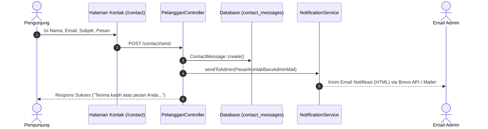

# Dokumentasi Implementasi Notifikasi Email Pesan Kontak Baru ke Admin

## 1. Latar Belakang & Tujuan

Sebelumnya, ketika pengunjung toko mengirimkan pertanyaan atau masukan melalui halaman **Hubungi Kami** (`/contact`), data pesan kontak hanya tersimpan ke dalam tabel database `contact_messages`. Admin hanya dapat mengetahui adanya pesan baru apabila membuka dasbor panel admin dan memeriksa badge counter di navbar atau sidebar.

Fitur ini dibuat untuk mengirimkan **notifikasi email otomatis secara realtime ke email Admin** setiap kali ada pengunjung yang mengirim pesan kontak, sehingga admin dapat segera merespons tanpa harus terus-menerus memantau panel admin.

---

## 2. Arsitektur & Alur Kerja Sistem

Pengiriman email dirancang selaras dengan arsitektur email Zyh Corner yang sudah berjalan (`NotificationService` dan `BrevoMailService`):

1. **Pengiriman Form Kontak**:
   Pengunjung mengirimkan formulir via `POST /contact/send` (mendukung pengiriman biasa maupun AJAX).
2. **Penyimpanan Pesan Kontak**:
   Controller melakukan sanitasi dan validasi data, lalu membuat record baru di tabel `contact_messages` dengan status awal `Belum Dibaca`.
3. **Penyebaran Notifikasi (*Dispatching Notification*)**:
   Controller memanggil `NotificationService::sendToAdmin(new PesanKontakBaruAdminMail($message))`.
4. **Penerima Notifikasi**:
   `NotificationService` mendeteksi seluruh akun dengan role `admin` di database (`User::where('role', 'admin')`), menggabungkannya dengan email kustom dari environment (`ADMIN_NOTIFICATION_EMAIL` jika ada), dan menghapus duplikasi.
5. **Kanal Pengiriman Multi-Layer & Toleransi Kesalahan (*Fault-Tolerance*)**:
   - Primer: Brevo HTTP API v3 (port 443 HTTPS, bebas blokir port SMTP hosting).
   - Sekunder: Fallback ke Laravel Mailer standar.
   - Pengiriman diapit blok `try-catch`, sehingga apabila jaringan mail server pihak ketiga mengalami kendala, pesan pengunjung tetap tersimpan dengan aman dan pengunjung tetap menerima pesan konfirmasi berhasil.



---

## 3. Berkas yang Dibuat & Dimodifikasi

| No | Tipe | Berkas | Deskripsi Perubahan |
|:--:|:---:|:---|:---|
| 1 | **Baru** | `app/Mail/PesanKontakBaruAdminMail.php` | Mailable class yang mengemas objek `ContactMessage`, subjek email dinamis `[Zyh Corner] Pesan Kontak Baru: {subjek}`, dan template view. |
| 2 | **Baru** | `resources/views/emails/pesan_kontak_baru_admin.blade.php` | Template email HTML responsif bergaya Zyh Corner lengkap dengan kartu rincian pengirim, blok isi pesan, serta tombol CTA *"Buka Dasbor Admin"*. |
| 3 | **Modifikasi** | `app/Services/NotificationService.php` | Menambahkan method statis `sendToAdmin($mailable)` yang mendistribusikan email ke seluruh admin terdaftar. |
| 4 | **Modifikasi** | `app/Http/Controllers/Pelanggan/PelangganController.php` | Menambahkan import Mailable, NotificationService, Log, serta memicu `sendToAdmin` setelah pesan tersimpan. |
| 5 | **Baru** | `tests/Feature/AdminContactMessageNotificationTest.php` | Test suite otomatis yang menguji pengiriman email notifikasi via form reguler, AJAX, dan validasi konten view mailable. |

---

## 4. Komparasi Perubahan Kode

### A. Mailable Baru (`app/Mail/PesanKontakBaruAdminMail.php`)
```php
<?php

namespace App\Mail;

use App\Models\ContactMessage;
use Illuminate\Bus\Queueable;
use Illuminate\Mail\Mailable;
use Illuminate\Queue\SerializesModels;

class PesanKontakBaruAdminMail extends Mailable
{
    use Queueable, SerializesModels;

    public $messageData;

    public function __construct(ContactMessage $messageData)
    {
        $this->messageData = $messageData;
    }

    public function build()
    {
        return $this->subject('[Zyh Corner] Pesan Kontak Baru: ' . $this->messageData->subjek)
                    ->view('emails.pesan_kontak_baru_admin');
    }
}
```

### B. Service Layer (`app/Services/NotificationService.php`)
```php
    /**
     * Send email notification to active admins and designated admin email.
     *
     * @param \Illuminate\Mail\Mailable $mailable
     * @return void
     */
    public static function sendToAdmin($mailable)
    {
        try {
            $testEmail = env('ADMIN_NOTIFICATION_EMAIL');
            
            $activeAdminEmails = User::where('role', 'admin')
                ->pluck('email')
                ->filter()
                ->toArray();

            $recipients = array_values(array_unique(array_filter(array_merge(
                $testEmail ? [$testEmail] : [],
                $activeAdminEmails
            ))));

            if (empty($recipients)) {
                $recipients = ['admin@zyhcorner.com'];
            }

            if (!empty($recipients)) {
                $mailable->build();
                $subject = $mailable->subject;
                $view = $mailable->view;
                $data = $mailable->buildViewData();
                $htmlContent = view($view, $data)->render();

                BrevoMailService::sendRecipients($recipients, $subject, $htmlContent);
                Log::info('Admin email notification sent via Brevo API to: ' . implode(', ', $recipients));

                if (app()->environment('testing')) {
                    Mail::to($recipients)->send($mailable);
                }
            }
        } catch (\Exception $e) {
            Log::error('Failed to send Admin email notification via Brevo: ' . $e->getMessage());

            try {
                if (!empty($recipients)) {
                    Mail::to($recipients)->send($mailable);
                }
            } catch (\Exception $fallbackEx) {
                Log::error('Fallback Laravel Mail also failed: ' . $fallbackEx->getMessage());
            }
        }
    }
```

### C. Controller Trigger (`app/Http/Controllers/Pelanggan/PelangganController.php`)
```php
        $message = ContactMessage::create([
            'nama' => strip_tags($validated['nama']),
            'email' => filter_var($validated['email'], FILTER_SANITIZE_EMAIL),
            'subjek' => strip_tags($validated['subjek']),
            'pesan' => strip_tags($validated['pesan']),
            'status' => 'Belum Dibaca',
        ]);

        // Kirim notifikasi email ke Admin
        try {
            NotificationService::sendToAdmin(new PesanKontakBaruAdminMail($message));
        } catch (\Exception $e) {
            Log::error('Gagal mengirim notifikasi email admin untuk pesan kontak: ' . $e->getMessage());
        }

        if ($request->ajax() || $request->wantsJson()) {
            return response()->json([
                'success' => true,
                'message' => 'Terima kasih atas pesan Anda! Tim Zyh Corner akan segera merespons melalui email.',
                'data' => $message,
            ]);
        }
```

---

## 5. Hasil Verifikasi & Uji Otomatis

1. **Pengujian Khusus Fitur Notifikasi (`AdminContactMessageNotificationTest`)**:
   ```bash
   php artisan test --filter=AdminContactMessageNotificationTest
   ```
   *Hasil*: **3 passed (13 assertions)** lulus 100%:
   - `contact message submission triggers admin email notification` (Pengiriman form standar memicu email ke admin).
   - `contact message ajax submission triggers admin email notification` (Pengiriman form via AJAX memicu email ke admin).
   - `mailable renders expected content and subject` (Subjek dan komponen template HTML ter-render akurat).

2. **Pengujian Fitur Dasbor Pesan Kontak (`AdminContactMessageTest`)**:
   ```bash
   php artisan test --filter=AdminContactMessageTest
   ```
   *Hasil*: **5 passed (25 assertions)** lulus 100%.

3. **Verifikasi Keseluruhan Sistem (`php artisan test`)**:
   ```bash
   php artisan test
   ```
   *Hasil*: **168 passed (852 assertions)** lulus 100% tanpa error maupun regresi.
