# Dokumentasi: Penghapusan Modal "Tambah Pesanan" & Pengalihan ke Pintasan Kasir POS (Point of Sale)

## 1. Latar Belakang & Rasional Arsitektur

Pada halaman kelola **Pesanan Online** (`/admin/orders`), sebelumnya terdapat tombol `+ Tambah Pesanan` yang membuka modal form `#addOrderModal`. Setelah dianalisis secara mendalam terhadap alur bisnis e-commerce Zyh Corner, ditemukan anomali dan risiko teknis yang signifikan:

1. **Anomali Data ("Pesanan Hantu" Tanpa Barang):**
   - Modal tersebut hanya meminta input: *Nama Pelanggan*, *Total Nominal (Rp)*, *Status Pembayaran*, dan *Status Pesanan*.
   - Tidak ada pilihan produk, varian produk, maupun kuantitas barang yang dibeli.
   - Kolom `items` pada tabel `pesanans` bernilai `null` atau kosong.
   - Saat invoice dicetak atau detail pesanan dibuka, daftar produk kosong dan menampilkan pesan *"Tidak ada item pesanan"*.
2. **Bypass Pengurangan Stok Inventaris (*Stock Reduction Bypass*):**
   - Karena tidak ada produk yang diikat ke transaksi, sistem tidak memotong stok persediaan barang. Hal ini menyebabkan ketidakcocokan antara stok fisik toko dengan catatan database.
3. **Kontradiksi Saluran (*Channel Conflict*):**
   - Halaman ini diperuntukkan untuk **Pesanan Online**, di mana pesanan secara kodrat harus dibuat oleh pelanggan melalui keranjang web (`/cart`) dan proses checkout (`/checkout`) dengan alamat pengiriman, perhitungan ongkir kurir, dan payment gateway.
   - Peran Admin/Kasir di halaman ini murni sebagai **pemroses dan pengawas** (memvalidasi pembayaran, mengubah status pesanan menjadi dikemas/dikirim, input resi pengiriman, dsb.).
4. **Sudah Ada Modul Kasir Offline (POS - Point of Sale):**
   - Untuk transaksi manual toko fisik, sistem Zyh Corner sudah memiliki modul **Kasir POS** di `/admin/pos`.
   - Modul POS telah teruji memotong stok secara otomatis (`ProductStockReductionTest`), mencatat item detail per produk, subtotal harga, serta jenis penjualan `Offline`.

Oleh karena itu, modal `#addOrderModal` dan tombol pemicunya dihapus, lalu digantikan dengan tombol pintas (*quick shortcut link*) yang mengarahkan Admin/Kasir langsung ke modul **Kasir POS** (`/admin/pos`).

---

## 2. Berkas yang Dimodifikasi

| No | Berkas | Tipe | Rincian Perubahan |
| :---: | :--- | :---: | :--- |
| 1 | `resources/views/Admin/kelola_penjualan/orders.blade.php` | Dimodifikasi | Mengganti tombol header menjadi link ke `route('pos.index')`, menghapus kontainer modal `#addOrderModal`, dan menghapus JavaScript auto-show modal saat validasi error. |
| 2 | `app/Http/Controllers/Admin/PesananController.php` | Dimodifikasi | Mengamankan metode `store()` agar mengalihkan (*redirect*) request manual ke modul Kasir POS disertai pesan edukatif. |

---

## 3. Rincian Perubahan Kode (Before vs After)

### A. `resources/views/Admin/kelola_penjualan/orders.blade.php`

#### 1. Header Action Button
* **Sebelumnya (Membuka Modal Anomali):**
  ```blade
  <div class="d-flex justify-content-center justify-content-md-end w-100 w-md-auto">
      <button type="button" class="btn btn-gradient-primary btn-sm px-4" data-bs-toggle="modal" data-bs-target="#addOrderModal">
          <i class="mdi mdi-plus me-1"></i> Tambah Pesanan
      </button>
  </div>
  ```
* **Sesudahnya (Pintasan Langsung ke Kasir POS):**
  ```blade
  <div class="d-flex justify-content-center justify-content-md-end w-100 w-md-auto">
      <a href="{{ route('pos.index') }}" class="btn btn-gradient-primary btn-sm px-3 d-inline-flex align-items-center shadow-sm" style="border-radius: 6px; font-weight: 500;" title="Transaksi manual kasir offline">
          <i class="mdi mdi-cash-register me-1" style="font-size: 16px;"></i> Buka Kasir POS
      </a>
  </div>
  ```

#### 2. Penghapusan Kontainer Modal `#addOrderModal`
Seluruh blok modal dihapus dari template:
```blade
<!-- DIHAPUS SEPENUHNYA: -->
<!-- Add Order Modal -->
<div class="modal fade" id="addOrderModal" tabindex="-1" aria-labelledby="addOrderModalLabel" aria-hidden="true">
    <div class="modal-dialog">
        <div class="modal-content" style="border-radius: 8px;">
            <div class="modal-header border-0 pb-0">
                <h5 class="modal-title font-weight-bold" id="addOrderModalLabel">Tambah Pesanan</h5>
                <button type="button" class="btn-close" data-bs-dismiss="modal" aria-label="Close"></button>
            </div>
            <form action="{{ route('orders.store') }}" method="POST">
                @csrf
                <div class="modal-body">
                    ...
                </div>
                <div class="modal-footer border-0 pt-0">
                    <button type="button" class="btn btn-light" data-bs-dismiss="modal">Batal</button>
                    <button type="submit" class="btn btn-gradient-primary">Simpan Pesanan</button>
                </div>
            </form>
        </div>
    </div>
</div>
```

#### 3. Penghapusan Script Auto-Open Modal pada Error Validasi
Bagian script pada event listener `DOMContentLoaded` dibersihkan dari pemanggilan modal yang sudah tidak ada:
```blade
<!-- DIHAPUS SEPENUHNYA: -->
@if(isset($errors) && is_object($errors) && method_exists($errors, 'any') && $errors->any() && old('_method') !== 'PUT')
    var myModal = new bootstrap.Modal(document.getElementById('addOrderModal'));
    myModal.show();
@endif
```

---

### B. `app/Http/Controllers/Admin/PesananController.php`

* **Sebelumnya (Membuat Data Pesanan Tanpa Item & Tanpa Potong Stok):**
  ```php
  public function store(Request $request)
  {
      $request->validate([
          'customer_name' => 'required|string|max:255',
          'payment_status' => 'required|string|in:Pending,Paid',
          'order_status' => 'required|string|in:menunggu pembayaran,menunggu konfirmasi,dikemas,dikirim,selesai,batal',
          'total' => 'required|numeric|min:0',
      ]);

      Pesanan::create([
          'order_number' => '#' . strtoupper(Str::random(6)),
          'customer_name' => $request->customer_name,
          'payment_status' => $request->payment_status,
          'order_status' => $request->order_status,
          'total' => $request->total,
      ]);

      return redirect()->route('orders.index')->with('success', 'Order created successfully.');
  }
  ```

* **Sesudahnya (Redirect Edukatif & Aman ke POS):**
  ```php
  public function store(Request $request)
  {
      return redirect()->route('pos.index')->with('info', 'Penambahan transaksi manual dilayani melalui sistem Kasir POS agar stok dan item produk tercatat dengan benar.');
  }
  ```

---

## 4. Alur Arsitektur Transaksi Baru

```mermaid
flowchart TD
    subgraph Saluran_Online [Pesanan Online Pelanggan]
        A[Pelanggan di Website] -->|Checkout Keranjang| B[Pesanan Masuk Database]
        B -->|Stok Terpotong Otomatis| C[Halaman Pesanan Online /admin/orders]
        C -->|Aksi Admin/Kasir| D[Konfirmasi, Kemas, Kirim, Resi, & Cetak Invoice]
    end

    subgraph Saluran_Offline [Transaksi Manual / Toko Fisik]
        E[Admin/Kasir di Pesanan Online] -->|Klik Tombol 'Buka Kasir POS'| F[Modul Kasir POS /admin/pos]
        F -->|Pilih Produk & Qty Nyata| G[Proses Transaksi POS]
        G -->|Stok Berkurang Real-Time & Tercatat di All Sales| H[Struk Kasir & Invoice Lengkap]
    end
```



---

## 5. Hasil Verifikasi & Pengujian

1. **Blade Compilation & View Cache:**
   ```bash
   php artisan view:clear && php artisan view:cache
   ```
   *Hasil:* Sukses (`Compiled views cleared successfully.` & `Blade templates cached successfully.`) tanpa ada sintaks error.

2. **Automated Test Suite:**
   ```bash
   php artisan test
   ```
   *Hasil Pengujian:*
   - **Total Tests:** 141 passed
   - **Total Assertions:** 710 assertions
   - **Status:** 100% Green (Lulus semua tanpa error maupun regresi).
   - Pengujian `ProductStockReductionTest`, `OrderConfirmationWorkflowTest`, dan `AdminBulkDeleteTest` tetap lulus sempurna.

---

## 6. Kesimpulan

Dengan penghapusan modal `#addOrderModal` dan penyediaan tombol jalan pintas (*shortcut*) ke modul Kasir POS:
1. Risiko munculnya data pesanan tanpa produk dan laporan omset fiktif berhasil dicegah secara menyeluruh.
2. Integritas persediaan barang (*inventory integrity*) terjaga 100% karena setiap transaksi offline diarahkan melalui POS yang memotong stok secara riil.
3. Antarmuka admin menjadi lebih bersih, ergonomis, dan sesuai dengan standar arsitektur sistem e-commerce modern.
